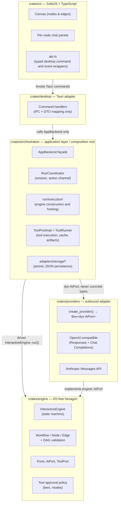

# Architecture

The engine owns workflow semantics, orchestration hosts runs and performs I/O, and providers implement model transport. The UI and desktop shell submit actions and display results.

## Filesystem

```text
architecture/
├── README.md                    # This index
├── end-to-end-runtime.md        # UI → desktop → orchestration → engine → providers (code-grounded)
├── technical-overview.md        # End-to-end overview with diagrams: context, caching, nodes/flow, harness design
├── contract.md                  # Layer responsibilities and dependency rules (source of truth)
├── orchestration-layout.md      # Orchestration module map and change paths
├── callable-agents.md           # Saved-agent snapshot and subagent model
├── provider-adapters.md         # Provider adapter families (Rig) and Bedrock notes
├── output-repair.md             # Overseer repair for malformed final-output submits
├── threading-concurrency.md     # Tokio runtimes, async tasks, blocking I/O risks
├── run-persistence.md           # Durable run storage, checkpoints, replay vs resume
└── diagrams/
    ├── README.md
    ├── layers-current-vs-target.mmd
    └── layers-legacy-names.mmd
```

## Implementation guides

| Topic | Guide |
| --- | --- |
| Run start, IPC, checkpoints, pauses, and resume | [Run lifecycle](end-to-end-runtime.md) |
| One agent’s turn: context, caching, tools, and completion | [Agent execution and context](technical-overview.md) |
| Dependencies, ports, and change review | [Architecture contract](contract.md) |
| Orchestration services, stores, and change locations | [Orchestration layout](orchestration-layout.md) |
| Saved-agent snapshots and subagent lifecycle | [Callable agents](callable-agents.md) |
| Rig provider families and Bedrock setup | [Provider adapters](provider-adapters.md) |
| Planning restrictions, approval, and frozen evidence | [Plan → Execute internals](plan-execute.md) |
| Repair of malformed final-output calls | [Overseer output repair](output-repair.md) |
| Current and target layer boundaries | [Layer diagram](diagrams/layers-current-vs-target.mmd) |
| Runtimes, I/O, and parallelism | [Threading and concurrency](threading-concurrency.md) |
| Checkpoints, replay, and resume after restart | [Run persistence](run-persistence.md) |

Product-facing behavior is summarized in [`../guides/runs.md`](../guides/runs.md), [`../guides/projects-and-persistence.md`](../guides/projects-and-persistence.md), and [`../reference/configuration.md`](../reference/configuration.md).

## Layer stack

```text
UI (crates/ui)
  → Desktop adapter (crates/desktop)
    → Orchestration (crates/orchestration)
      → Engine (crates/engine)
      → Provider adapters (crates/providers) via AiPort
```

Orchestration owns runtime execution state and `ToolPortImpl`. Engine owns the workflow state machine and ports. Provider adapters own wire transport.

[Coding patterns](../contributing/coding-patterns.md) identifies owning files and runtime rules. [AGENTS.md](../../AGENTS.md) maps common changes to those owners; [architecture check config](../../crates/workspace-checks/arch-check-rules.toml) defines the enforced boundaries.


## System boundaries

OpenFlow separates the desktop UI, command bridge, runtime host, engine, and providers. The dependency boundaries are enforced by [`../../scripts/check-architecture.sh`](../../scripts/check-architecture.sh), which reads [`../../crates/workspace-checks/arch-check-rules.toml`](../../crates/workspace-checks/arch-check-rules.toml).



CI checks these constraints:

| Rule | Enforcement |
|---|---|
| Engine has **zero I/O**: no filesystem, no HTTP, no `unwrap`/`expect`/`panic` | Clippy denies + forbidden-dep table (`reqwest`, `tauri` banned in engine) |
| Only `orchestration/run/execution/` may construct `InteractiveEngine` | Tier-3 arch check |
| Desktop imports `orchestration::Workflow`, never `engine::Workflow` | Re-export boundary; ban tables |
| Orchestration may only import `create_provider` + config types from providers | Allowlist; `AiClient` banned |
| Engine public API is snapshot-tested | `crates/engine/tests/snapshots/public_api.txt` |

The engine owns workflow validity and execution behavior. Orchestration stores, configures, and hosts runs; providers implement model transport. The UI owns presentation and interaction, while desktop bridges its commands and events.
