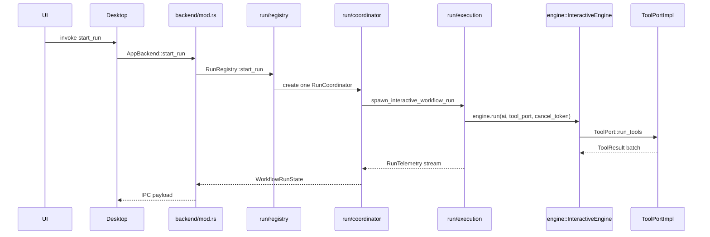

# Orchestration crate layout

`crates/orchestration/src` is grouped by app concern. Entity folders hold application logic and port traits. Centralized `adapters/` folders hold the concrete storage, tool, MCP, git, and LSP implementations.

Engine semantics stay in `crates/engine`. Orchestration wires the engine to providers, stores, tools, projects, and desktop-facing state.

## Module paths

Rust module paths match the folder layout: `backend/mod.rs` is `orchestration::backend`, `workflow/catalog.rs` is `orchestration::workflow::catalog`, and `run/execution/` is `orchestration::run::execution`. The tables below list files only. Three adapter folders are re-exported under aliases:

| Folder | Alias |
| --- | --- |
| `adapters/tool_impl/` | `orchestration::tools` (internal) |
| `adapters/infrastructure/git` | `orchestration::git` (public) |
| `adapters/infrastructure/lsp` | `orchestration::lsp` (public) |

## Roles

| Role | Folder | Job |
| --- | --- | --- |
| Composition | `backend/` | Construct services; expose the stable facade that desktop calls. |
| Application services | `workflow/`, `agent.rs`, `project/`, `settings/`, `schedule/`, `run/`, `terminal.rs`, `tool/` | Apply app rules, coordinate ports, return API DTOs. |
| Port traits | `{entity}/ports.rs` or `agent.rs` | Define store/catalog seams consumed by entity services. |
| Run state | `run/state.rs` | Project `RunTelemetry` into `WorkflowRunState` for UI and IPC. |
| Concrete storage | `adapters/storage/` | Read and write JSON under `{data_local}/openflow/`, project workflow files, and run checkpoints. |
| Runtime I/O | `adapters/tool_impl/`, `adapters/mcp/`, `adapters/infrastructure/` | Filesystem, subprocess, MCP, git, and LSP work. |
| Shared DTOs | `api.rs`, `error.rs` | Transport shapes and the crate-wide `BackendError`. |

## Directory map

Desktop and UI call `backend/`, which composes the services below it. Files inside each folder are listed in the [entity reference](#entity-reference).

```text
orchestration/src/
├── lib.rs
├── api.rs
├── error.rs
├── backend/                     AppBackend facade and composition root
│   ├── mod.rs
│   └── tests.rs
├── adapters/
│   ├── storage/                 JSON and checkpoint persistence (*_store.rs)
│   ├── tool_impl/               concrete read/search/write/bash/edit tools
│   ├── mcp/                     MCP discovery and run clients
│   └── infrastructure/          git and LSP integrations
├── agent.rs                     saved agent library
├── chat.rs                      saved direct-chat metadata
├── diagnostics.rs
├── project/                     project registry and file references
├── run/                         run registry, per-run coordinators, checkpoints, state projection
├── schedule/                    schedule evaluation and status
├── settings/                    settings facade, provider readiness, skills
├── terminal.rs                  embedded terminal sessions
├── tool/                        tool registry, dispatch, retry, output
└── workflow/                    workflow catalog and authoring services
```

## Entity reference

### Workflow

| File | Responsibility |
| --- | --- |
| `workflow/catalog.rs` | Merge app and project workflows; assign, unassign, rename, and split saves. |
| `workflow/authoring/` | AI-assisted workflow draft and validation turns. |
| `workflow/ports.rs` | Workflow store traits consumed by the catalog. |
| `adapters/storage/app_workflow_store.rs` | Persist app-level `workflows.json`. |
| `adapters/storage/project_workflow_store.rs` | Discover and save per-project workflow files. |

The catalog owns merge policy. Stores only read and write bytes.

### Agent

| File | Responsibility |
| --- | --- |
| `agent.rs` | Callable agent CRUD, `create_agent_node`, and the agent store trait. |
| `adapters/storage/agent_store.rs` | Persist `openflow/agents.json`. |

### Chat

| File | Responsibility |
| --- | --- |
| `chat.rs` | Persisted Chat identity, project/runtime config, title, timestamps, and durable run reference. |
| `backend/chat.rs` | Direct-chat commands and private workflow execution adapter. |
| `adapters/storage/chat_store.rs` | Persist `openflow/chats.json` separately from the workflow catalog. |

### Project

| File | Responsibility |
| --- | --- |
| `project/registry.rs` | Register and load project folders. |
| `project/file_refs.rs` | Read project file-reference content. |
| `project/ports.rs` | Project store trait and project DTO. |
| `adapters/storage/project_store.rs` | Persist `openflow/projects.json`. |

### Run

| File | Responsibility |
| --- | --- |
| `run/registry.rs` | Addressable top-level sessions keyed by `run_id`; shared execution resources. |
| `run/coordinator/mod.rs` | One session mutex; `start_run`, `submit_*`, `stop_run`, resume, replay, interrupts. |
| `run/execution/` | Host loop, AI adapter, `ToolPortImpl`, headless execution, telemetry event projection. |
| `run/handoff.rs` | Validate, atomically persist, hash, and resolve canonical Markdown/JSON node handoffs. |
| `run/persistence.rs` | Durable run roots, records, and checkpoint metadata. |
| `run/ports.rs` | Run checkpoint store trait. |
| `run/skill_invocation.rs` | Resolve installed task-prompt skill tokens into frozen runtime prompt guidance. |
| `run/state.rs` | `WorkflowRunState` projected for UI and IPC. |
| `adapters/storage/run_checkpoint_store.rs` | Persist run records and engine checkpoints. |

Only `run/execution/` constructs or drives `InteractiveEngine`, as the [architecture contract](contract.md) requires.

### Settings

| File | Responsibility |
| --- | --- |
| `settings/facade.rs` | Settings UX backend: redaction, skill list, provider readiness, validation summary. |
| `settings/provider.rs` | Key precedence: transient input, stored key, then environment. |
| `settings/model.rs` | Persisted settings DTOs. |
| `settings/ports.rs` | Settings and skill catalog traits. |
| `adapters/storage/settings_store.rs` | Persist `settings.json`. |
| `adapters/storage/skill_store.rs` | Scan configured roots for `SKILL.md` files. |

### Tool and infrastructure

| File or folder | Responsibility |
| --- | --- |
| `tool/registry.rs` | Register builtin tools with their `ToolTier` and `ToolConcurrency`. |
| `tool/runner.rs` | Execute registered tools and persist large artifacts. |
| `tool/dispatch.rs` | Route calls to concrete tool implementations. |
| `tool/retry.rs` | Retry transient tool failures according to workflow policy. |
| `adapters/tool_impl/` | Concrete read, ls, search, find, write, edit, bash, grep, and patch implementations. |
| `adapters/mcp/` | MCP server discovery and per-run clients. |
| `adapters/infrastructure/git` | Execution-cwd-scoped diff and revert operations. |
| `adapters/infrastructure/lsp` | LSP settings and format/diagnostic integration. |

### Diagnostics, schedule, and terminal

| File or folder | Responsibility |
| --- | --- |
| `diagnostics.rs` | Append optional local debug output to a process-specific JSONL file in the system temporary directory. |
| `schedule/` | Evaluate workflow schedules and status. |
| `terminal.rs` | Manage embedded terminal sessions. |

## Request flow: start a run



- `AppBackend` delegates run lifecycle operations to `RunRegistry`, which owns one `RunCoordinator` per live or retained in-process run.
- Different workflows may run concurrently. The registry rejects a second active run for the same workflow and targets 64 retained sessions, evicting inactive sessions first. Active sessions are never evicted.
- Registry operations take an optional run ID internally. An explicit ID selects that session, and a missing explicit ID returns an error. Omitting the ID selects the latest session, for legacy backend calls. `AppBackend` keeps separate addressed and legacy methods for existing consumers.
- The coordinator completes fallible launch setup, including durable resume status writes, before spawning execution. It then installs handles without an intervening await.
- The headless runner cancels and joins execution on return. Dropping its future cancels and aborts the owned task.
- Hashline editing uses one concrete snapshot store. A single mutex protects versions and path recency, so concurrent writes cannot bypass eviction.
- Bash and MCP package installation share the process-group cleanup helper in `adapters/infrastructure/process.rs`.

## Where to add code

| Change | Put it here |
| --- | --- |
| New workflow merge rule | `workflow/catalog.rs` |
| New workflow file layout | `adapters/storage/app_workflow_store.rs` or `adapters/storage/project_workflow_store.rs` |
| New project registry behavior | `project/registry.rs`, plus `project/ports.rs` if the store seam changes |
| New run lifecycle step | `run/coordinator/mod.rs` or `run/execution/` |
| New UI run field | `run/state.rs`, plus `engine::RunTelemetry` if the engine emits new state |
| New builtin tool | `adapters/tool_impl/`, `tool/registry.rs`, `tool/dispatch.rs`, and `crates/engine/src/tools/config.rs`; also update `NODE_RUNTIME_PREAMBLE` in `crates/engine/src/execution/node_invocation.rs` |
| New settings field | `settings/model.rs`, `adapters/storage/settings_store.rs`, and `settings/facade.rs` if UI-facing |
| New desktop command | Delegate in `backend/mod.rs`; implement in the owning service module |

## Import rules

| Folder | May import |
| --- | --- |
| `backend/` | Entity services, storage adapters, `api`, and `error`. |
| `workflow/`, `agent/`, `project/`, `settings/`, `tool/` | Engine types, local ports, sibling modules, and shared DTOs. Never `crate::adapters::`. |
| `run/` | Engine types, providers through `AiPort`, tool infrastructure, run ports, and run state. |
| `adapters/storage/` | Engine types, entity port traits, filesystem/JSON support. |
| `adapters/tool_impl/`, `adapters/mcp/`, `adapters/infrastructure/` | Engine tool types and concrete I/O crates. |

Cross-entity work goes through services or `backend/`. Entity services should depend on port traits when a concrete store would otherwise leak persistence details.

## Persistence locations

All owning modules are under `orchestration/src/adapters/storage/`.

| Data | Location | Owning module |
| --- | --- | --- |
| App workflows | `{data_local}/openflow/workflows.json` | `app_workflow_store.rs` |
| Projects | `{data_local}/openflow/projects.json` (migrates from legacy slug) | `project_store.rs` |
| Saved agents | `{data_local}/openflow/agents.json` (migrates from legacy slug) | `agent_store.rs` |
| Settings | `{data_local}/openflow/settings.json` | `settings_store.rs` |
| Project workflows | `{project}/.flow/workflows/{workflowId}.workflow.json` | `project_workflow_store.rs` |
| Provider API keys | Plaintext in `settings.json` (`ProviderProfile.api_key`) | `settings_store.rs` |
| Skills | Discovered at runtime from Cursor/Claude/Agents skill dirs (not persisted) | `skill_store.rs` |

`AppBackend::load_all_workflows` merges app-store workflows with project-discovered workflows; project files win on ID collision.

`run_checkpoint_store` writes to `{data_local}/openflow/runs/` or the project-scoped run root that orchestration selects. [Data locations](../reference/README.md) lists run attachments, handoffs, and credential storage.
