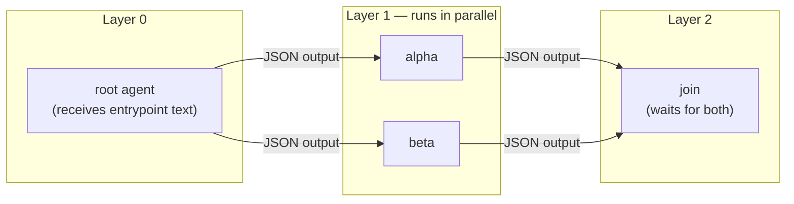
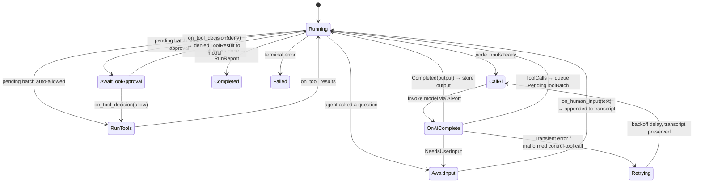
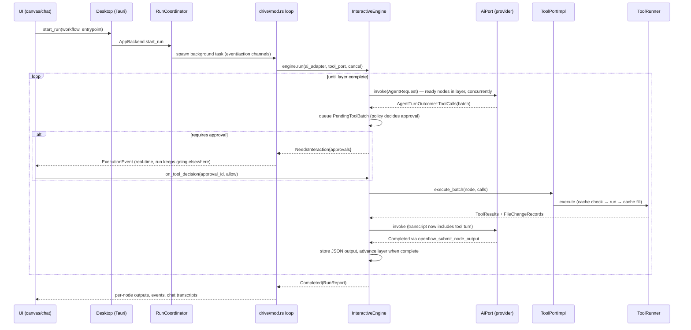
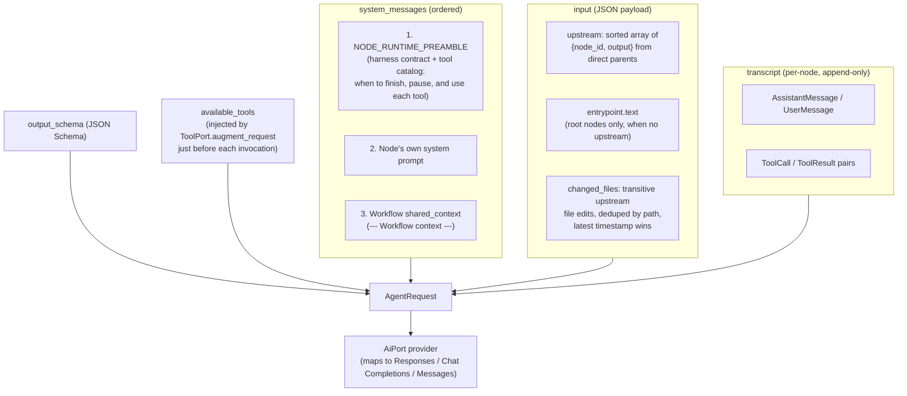
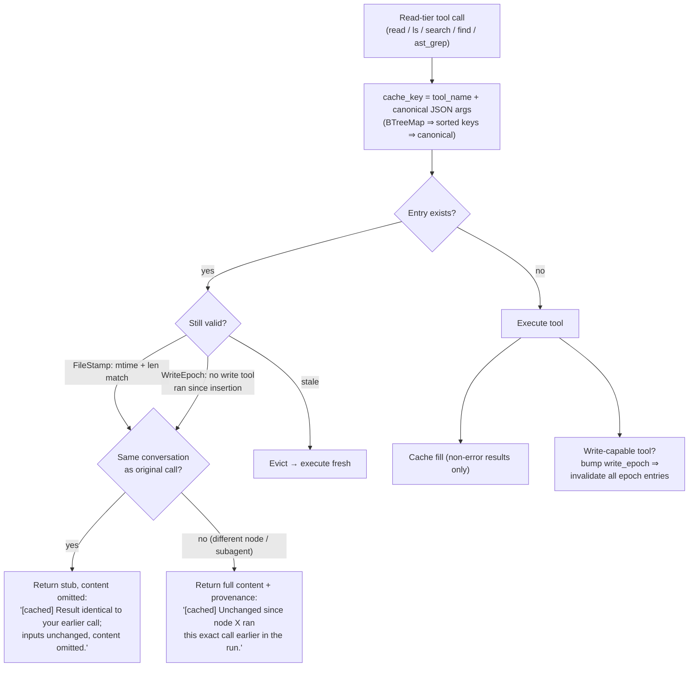
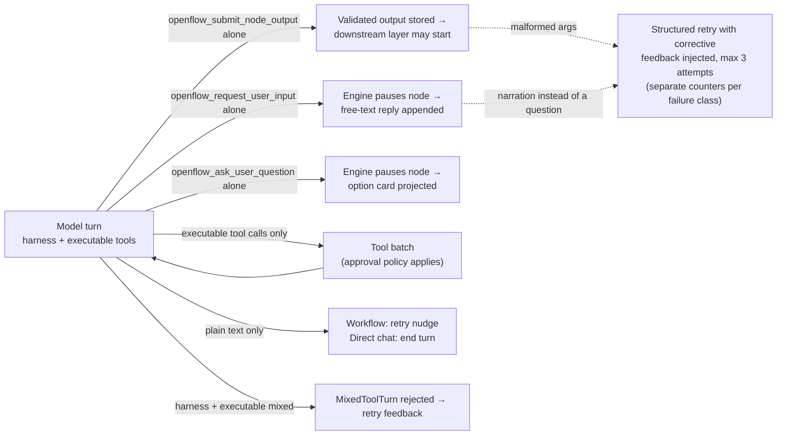
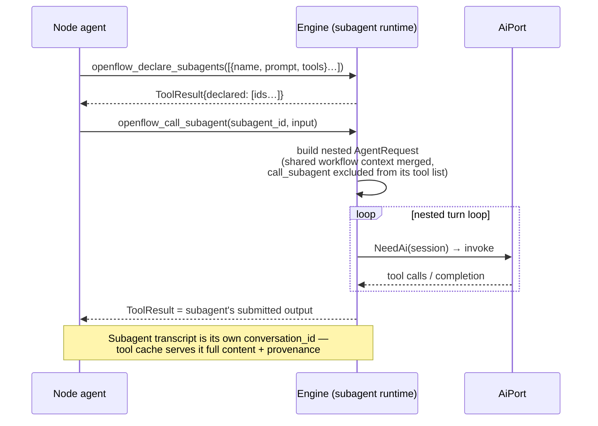

# Agent execution and context

The engine schedules agent nodes, assembles their context, and advances the graph when their outputs satisfy the handoff contract. Orchestration supplies model and tool I/O, stores run state, and sends events back to the UI.

See [system boundaries](README.md#system-boundaries) for where the engine and its I/O adapters sit, and [Run lifecycle](end-to-end-runtime.md) for launch, checkpointing, and resume.

## 2. Nodes and flow

A workflow is a DAG of agent nodes. Validation ([graph/validation.rs](../../crates/engine/src/graph/validation.rs)) topologically sorts it into **execution layers**: every dependency of a node sits in an earlier layer, and a layer's nodes run **concurrently**.

### The engine state machine

[`InteractiveEngine`](../../crates/engine/src/execution/interactive_engine/mod.rs) is a **sans-I/O state machine**: concrete model and tool I/O lives in the `AiPort` and `ToolPort` implementations. `run()` calls those ports until the workflow completes, fails, cancels, or returns `NeedsInteraction`. The host feeds human input and approvals back through `on_*` handlers, then calls `run()` again.

`EngineRunResult::NeedsInteraction` batches paused nodes in `inputs`, `approvals`, and `retryables`, so the UI shows pending work from parallel branches together. Completion, failure, and cancellation are terminal results.

### One full node turn, end to end

## 3. Context assembly

Context is **engine-owned and deterministic** ([node_invocation.rs](../../crates/engine/src/execution/node_invocation.rs)). Providers map the `AgentRequest` to wire format verbatim and never edit prompts.

- **Deterministic ordering.** Upstream outputs are sorted by node ID and `serde_json::Value` maps are BTreeMap-backed, so the same graph state yields byte-identical input. The tool-result cache can therefore key on raw arguments (§4).
- **Transitive file-change provenance.** `upstream_changed_files` merges `FileChangeRecord`s from *all* transitive ancestors, not just direct parents; rename chains collapse to the destination path. A node three hops downstream starts with the run's recorded file changes without rereading the files.
- **Node transcripts.** Each node has its own append-only transcript of `AgentTranscriptItem`s. Human replies, tool turns, and retries extend it, so a retried node *continues* rather than restarts.
- **Tool catalog in preamble.** `NODE_RUNTIME_PREAMBLE` gives when-to-use guidance for every builtin and harness tool; per-turn `available_tools` schemas stay authoritative for parameters. **When you add or materially change a tool**, update both `orchestration/src/tool/registry.rs` (schema + description) and the `## Available tools` section of `NODE_RUNTIME_PREAMBLE` in `engine/src/execution/node_invocation.rs`. New harness tools (e.g. submit, request input) also need matching preamble sections.

## 4. Caching

OpenFlow has two independent cache layers:

- **Provider prompt caching** reuses exact LLM prompt prefixes ([provider adapters](provider-adapters.md#provider-prompt-caching)).
- The **per-run, cross-node, validated tool-result cache** ([tool/cache.rs](../../crates/orchestration/src/tool/cache.rs), served from [tool/runner.rs](../../crates/orchestration/src/tool/runner.rs)) stops downstream agents re-reading files and re-running searches their parents already ran.

1. **Validation at hit time, not TTL.** Single-file reads carry an `mtime + length` stamp, checked against the live filesystem on every lookup. Multi-file results (search, directory reads) carry a **write epoch**, a global counter bumped whenever any write-capable tool runs or an edit batch is reverted. These checks catch observed changes only; they can't detect external writes that preserve metadata or bypass the run's write epoch.
2. **Conversation-aware degradation.** The cache records which transcript got the original result (`conversation_id` = node ID, or a unique session ID for subagents). A repeat from the *same* transcript gets a content-omitting stub, because the content is already in the model's context and resending it costs input tokens. A repeat from a *different* node gets full content plus a provenance note, so the model can identify the earlier result. Freshness is still bounded by the filesystem checks above.
3. **Per-run scoping.** The cache lives on the per-run `ToolRunner` built in `drive/setup.rs`. It is never persisted or shared across runs.

Large outputs and file-change summaries use separate mechanisms:

- **Artifact spill** ([tool/output.rs](../../crates/orchestration/src/tool/output.rs)): tool output over 50 KB goes to a per-run artifact directory. The model gets the head (20 KB) and tail (20 KB) plus a marker naming the artifact ID, through which the full output stays retrievable.
- **Changed-files records** (§3) carry file-edit summaries downstream in graph input. If a node then reads those files, the cache decides whether the earlier result is reusable.

## 5. Agent completion and interaction

### 5.1 Completion is a tool call, not text

A workflow node completes only by calling `openflow_submit_node_output` with `{output: <schema-conforming object>, assistant_message}`. The runtime preamble says so: "Plain assistant text does not finish the node and does not advance the workflow". Direct-chat nodes use `conversationMode`, where a plain assistant message ends one conversation turn without completing the node.

Every turn advertises `openflow_submit_node_output`, the optional human-input harnesses, and the node's executable catalog tools together. The human-input harnesses are explicit: `openflow_request_user_input` asks one free-text question, and `openflow_ask_user_question` presents structured choices. A response calls exactly one harness tool alone, or executable tools only. Providers reject a mix as `MixedToolTurn`, and the engine retries with corrective feedback. Workflow requests use required tool choice; direct-chat requests use automatic tool choice, so the provider may return plain text or `openflow_ask_user_question`.

Malformed harness-tool calls get **class-specific retry budgets** with targeted corrective feedback, separate from transient-network retry counters. For example, `MALFORMED_REQUEST_INPUT_FEEDBACK` distinguishes a free-text `assistant_message` from structured `questions`. When the input retry budget runs out, the node fails rather than surfacing malformed input. Plain provider text pauses only `conversationMode` nodes; ordinary workflow nodes need a valid human-input tool call.

### 5.2 Human input is an explicit runtime request

Every node starts as soon as its upstream inputs are ready. A node configured with `request_user_input` may then call `openflow_request_user_input` (free text) or `openflow_ask_user_question` (choices). Orchestration resumes the same state machine through `InteractiveEngine::on_human_input` and `InteractiveEngine::on_tool_decision`. Branch A can wait for input while branch B keeps executing tools; `NeedsInteraction` reports the paused nodes together.

### 5.3 The engine is sans-I/O

`InteractiveEngine::run()` is the sole execution entry. It drives model and tool I/O through port traits until it returns `EngineRunResult`. On `NeedsInteraction`, orchestration blocks on the action channel, applies `on_human_input` / `on_tool_decision` / `retry_node`, and calls `run()` again.

Clippy denies `unwrap`/`expect`/`panic`, `std::fs` is disallowed, and architecture checks ban transport crates, so retry classification, approval policy, layer advancement, and interruption are testable as state transitions.

### 5.4 Subagents as a resumable state machine: declared at runtime by the model

Subagents follow the same sans-I/O discipline ([subagent_runtime.rs](../../crates/engine/src/execution/subagent_runtime.rs)): the engine exposes a step enum (`SubagentInvokeStep::NeedAi | Done`), and orchestration's `SubagentSession` drives the loop. They come from two sources:

- **Snapshot agents**: saved `CallableAgent`s frozen at run start (no mid-run mutation races).
- **Ad-hoc declaration**: mid-turn, the model calls `openflow_declare_subagents` to define subagents (name, prompt, tools), then fans work out via `openflow_call_subagent`. The graph defines dependencies between nodes; subagents let a node divide its own task during execution.

Recursion is structurally bounded: the registry builds a distinct tool definition set for subagent contexts that excludes `openflow_call_subagent`.

### 5.5 Tiered approval with policy as pure domain logic

Approval policy lives in the **engine**, not the UI ([tools/config.rs](../../crates/engine/src/tools/config.rs)):

| Piece | Values |
| --- | --- |
| Tool tier | `Read`, `Write` |
| Node `ApprovalMode` | `ReadOnly`, `Yolo`, `Write`, `AlwaysAsk` |
| `tool_decision_for_call` result | `AutoAllow`, `Prompt`, `Deny` |

Orchestration filters write-tier tools out of the `ReadOnly` catalog. The engine queues `Prompt` batches as `AwaitToolApproval`. A denial returns a denied `ToolResult` to the model, which can adapt and continue toward submit.

### 5.6 Interruption, retry, and revert as first-class state

- `mark_node_interrupted` cancels a node's pending tool batches mid-flight without failing the run; the node surfaces as a `retryable` in `NeedsInteraction`.
- `retry_node` keeps the transcript, so the next request includes the earlier conversation. `model_attempt` increments so providers and telemetry can tell attempts apart.
- Edit batches are revertible: `revert_file_changes_for_batch` removes their records from downstream provenance and bumps the cache write epoch, invalidating affected cached results.

## 6. File map (orientation)

| Concern | Where |
|---|---|
| State machine, `run()` loop | `crates/engine/src/execution/interactive_engine/` |
| Context assembly, runtime preamble | `crates/engine/src/execution/node_invocation.rs` |
| Layering / DAG validation | `crates/engine/src/graph/validation.rs` |
| Ports (AiPort, ToolPort) | `crates/engine/src/ports/` |
| Subagent state machine | `crates/engine/src/execution/subagent_runtime.rs` |
| Approval policy / tiers | `crates/engine/src/tools/config.rs` |
| Run driver and setup | `crates/orchestration/src/run/execution/drive/` |
| Tool execution + cache + artifacts | `crates/orchestration/src/tool/{runner,cache,output}.rs` |
| Provider factory + wire mapping | `crates/providers/src/` |
| Architecture rules (CI) | `crates/workspace-checks/arch-check-rules.toml` |
