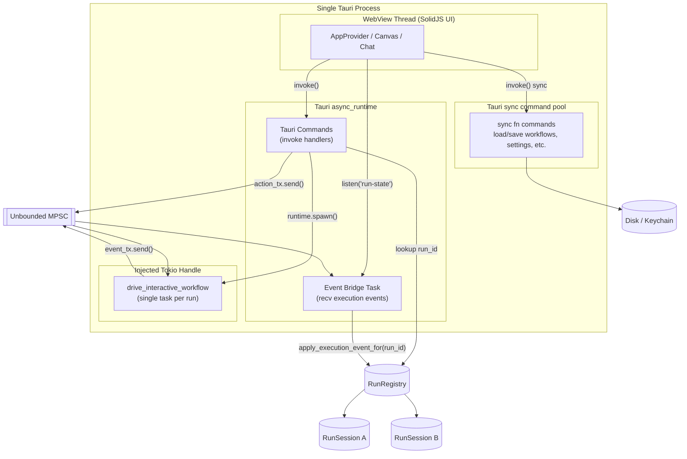
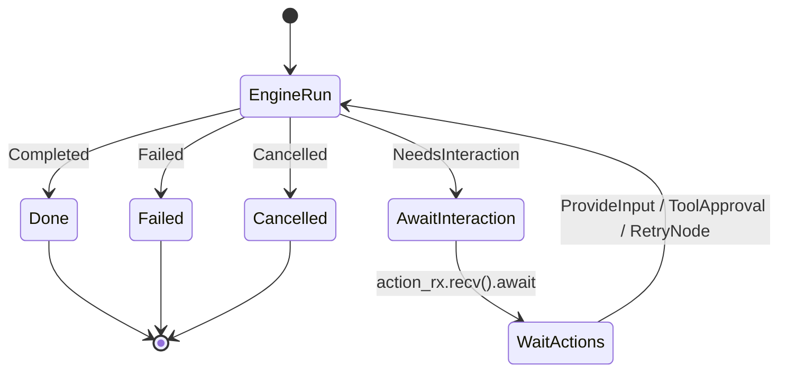
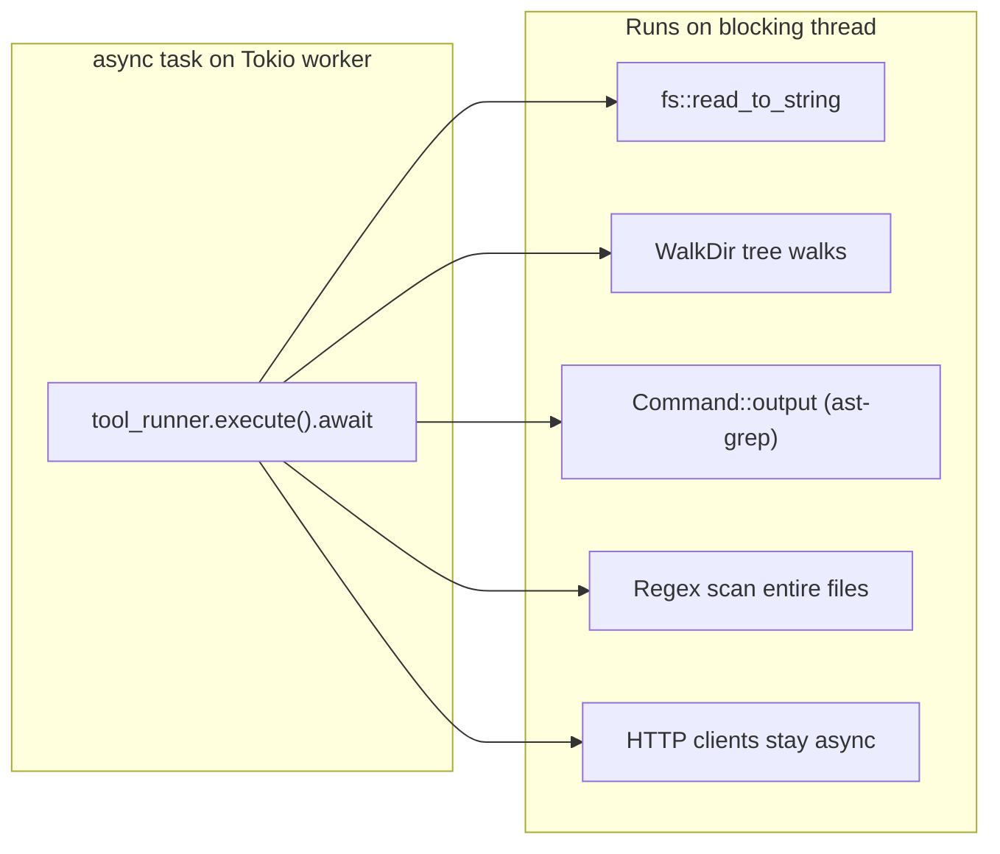
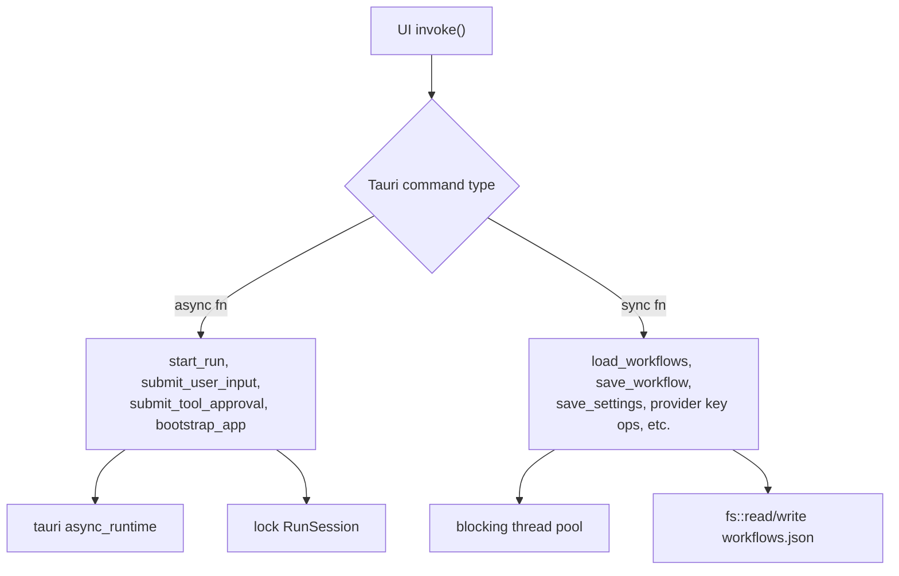
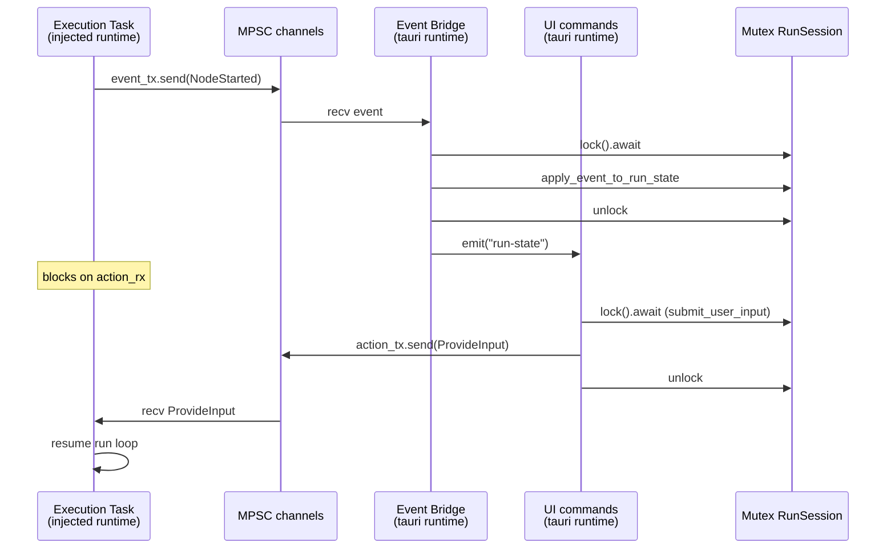
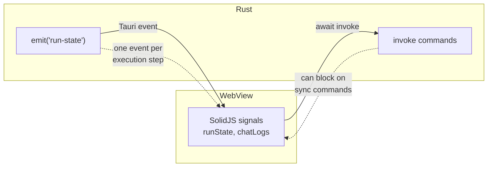
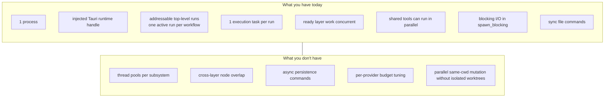

# Threading and concurrency

Orchestration runs on the Tauri Tokio runtime handle in the desktop app. Each workflow run has one execution task. Within a DAG layer, ready AI calls and tool batches run concurrently via `FuturesUnordered`, and completions apply to engine state one at a time. The [architecture contract](contract.md) defines ownership across the runtime boundaries.

Concurrency constraints:

1. **Runtime split outside Tauri**: tests or helper entry points can construct `AppBackend` with a separate owned runtime through `AppBackend::new(...)`.
2. **Blocking I/O coverage** depends on dispatching filesystem and subprocess work through `spawn_blocking`.
3. **Layer-bounded concurrency**: independent nodes overlap only while they share a ready layer; later layers still wait.
4. **Addressable run sessions** share provider/tool budgets and hold one mutation lease per canonical execution cwd.
5. **Many sync Tauri commands** do filesystem or settings I/O on the command thread pool.

## Process & runtime topology

Everything runs in **one Tauri desktop process**. In production, desktop injects `tauri::async_runtime::handle()` into `AppBackend::with_runtime_handle()`, and workflow execution is spawned from that handle.



### Where each runtime lives

| Component | Runtime | File |
| --- | --- | --- |
| Workflow execution task | injected `tokio::runtime::Handle` | `crates/orchestration/src/backend/mod.rs`, `crates/orchestration/src/run/execution/mod.rs` |
| Tauri commands + event fanout | `tauri::async_runtime` | `crates/desktop/src/lib.rs` |
| Sync file commands | Tauri blocking pool | `crates/desktop/src/lib.rs` |

- `AppBackend::with_runtime_handle()` uses the handle desktop passes in. Tests can instead create an owned `tokio::runtime::Runtime` and pass its handle to `AppBackend::new(...)`.
- `spawn_interactive_workflow_run()` (`crates/orchestration/src/run/execution/mod.rs`) spawns workflow runs.
- `start_run()` (`crates/desktop/src/lib.rs`) spawns the event bridge on `tauri::async_runtime`. The bridge receives execution events, applies them to run state, and emits `run-state` to the UI.

### Issue: runtime split outside the desktop path

On the desktop path, command tasks and run execution share the Tauri runtime handle. Tests or bespoke non-Tauri entry points may still construct `AppBackend` with a separate owned runtime. That split is useful for local construction but must not become the production path: keep desktop execution on the injected handle, and reserve owned runtimes for tests or explicit non-Tauri entry points.

## Workflow execution model (one task, concurrent layer work)

Each run is a **single async task**. Inside it, `InteractiveEngine::run()` drives a `FuturesUnordered` of ready work: model invocations and tool batches for every node runnable in the layer. Completions apply serially as they arrive. Within one tool batch, `ToolPortImpl` runs adjacent `ToolConcurrency::Shared` tools in parallel and serializes `ToolConcurrency::Exclusive` tools with per-tool semaphores.



The host loop, `drive_interactive_workflow()` (`crates/orchestration/src/run/execution/drive/mod.rs`), calls `InteractiveEngine::run()`. The engine invokes `AiPort` and `ToolPort` internally until it completes, fails, or returns `NeedsInteraction`.

### Layer parallelism (implemented)

`execution_layers()` groups nodes by dependency depth. For the active layer, `InteractiveEngine` schedules every ready AI call and tool batch into one `FuturesUnordered` pool (`crates/engine/src/execution/interactive_engine/mod.rs`). Independent nodes in a layer overlap in wall time; state updates stay single-threaded on completion.

### Subagent waits

A subagent runs inside its parent's tool batch and shares `ai`, `tool_runner`, and channels. The parent waits for its result. Other ready nodes in the layer continue through the engine's `FuturesUnordered` pool, so the subagent does not block the whole run.

## Blocking I/O coverage

`ToolRunner` and `RunCoordinator` use **`spawn_blocking`** for search/find/write/edit/patch, local reads, preview/git/revert, execution cwd resolution, and large artifact spills. Desktop and orchestration share one **injected Tokio `Handle`** (the Tauri runtime in production).

`ToolRunner::execute` is `async`. Keep concrete local filesystem and subprocess work inside blocking tasks:



Sync work in `crates/orchestration/src/tool/dispatch.rs` and `crates/orchestration/src/run/coordinator/mod.rs`:

- `fs::read_to_string`, `fs::read_dir`, `fs::metadata`
- `WalkDir` over large trees
- `Command::new("ast-grep").output()` (sync subprocess wait)
- `search()`, which reads every file and runs the regex on every line

`read_url` uses async HTTP. Local filesystem and subprocess tools should keep using `spawn_blocking`.

### Impact

A large `search` or `find` call can still consume blocking-pool capacity:

1. The run task waits for the blocking work to finish.
2. Other blocking tasks can queue behind long file scans or subprocess calls.
3. UI commands that also need blocking-pool work can feel delayed.

## Tauri command threading

Most commands are **synchronous `fn`**, not `async fn`. Only a handful are `async fn`; the rest block a Tauri worker. Sync commands call straight into orchestration stores (`crates/orchestration/src/adapters/storage/`).



### Impact

- Saving workflows during an active run competes for disk I/O on a blocking pool thread. Usually fine, but large files can delay command responses.
- Provider API key load/save reads and writes `settings.json` synchronously.
- The UI awaits `invoke()`, so long sync commands make the app feel frozen.

## Run session locking & channels

Each run keeps its lifecycle state behind its own mutex:



### Issues

| Issue | Detail |
| --- | --- |
| **Per-run mutex** | Events and controls for one run contend on that run's `RunSession`; independent runs do not share the lock |
| **Clone on hot path** | `apply_execution_event` clones the full `Workflow` and `WorkflowRunState` on each event |
| **Unbounded channels** | `unbounded_channel()`: fast event bursts can grow memory without backpressure |
| **Shared capacity** | Active runs across different workflows may exceed the 64-session retention target; provider calls and executable tools wait on shared process budgets |
| **Same-cwd mutations** | Write-capable runs sharing a canonical cwd serialize for the whole run; read-only runs and different roots can overlap |

## UI ↔ backend boundary

The UI is single-threaded (SolidJS in WebView) and spawns no threads. Slow backend work shows up as delayed IPC responses or event delivery:



`useRunSession` (via `context/appProvider/`) listens for `run-state` events and updates run signals. Every execution step (node start, tool call, chat message) emits a full state snapshot, so high-frequency tool loops mean many serializations and IPC round-trips.

## Tool concurrency controls

`ToolConcurrency` lives in the engine tool model (`crates/engine/src/tools/config.rs`). `crates/orchestration/src/tool/registry.rs` registers each builtin tool as `Shared` or `Exclusive`.

- **Per run**: `ToolPortImpl` runs adjacent shared tools in parallel. Each run keeps its own per-tool `tokio::sync::Semaphore` for `ToolConcurrency::Exclusive` tools and acquires it before execution (`crates/orchestration/src/run/execution/tool_port.rs`). This keeps tools such as write, edit, bash, and apply-patch from running concurrently with the same tool name inside a run.
- **Across runs**: all runs acquire process-wide permits in `run/resources.rs`, by default 8 concurrent provider invocations and 16 concurrent executable tools. These budgets queue work.
- **Sessions**: different workflows may run concurrently, but one workflow owns at most one active run; `RunRegistry` rejects a second. The registry targets 64 in-process sessions by evicting the oldest inactive session first. It never evicts active sessions, so the count may temporarily exceed 64. Durable run records remain on disk.

## Issue severity matrix

| Priority | Issue | Symptom |
| --- | --- | --- |
| **P0** | Long blocking filesystem or subprocess tasks | UI commands can wait behind search/find/ast-grep on large repos |
| **P1** | Non-Tauri owned runtime path | Extra runtime split if production code accidentally constructs `AppBackend` around its own runtime |
| **P1** | Sync Tauri commands for persistence | Invoke hangs on save/load during heavy I/O |
| **P2** | Subagents in nested loop, same task | Parent node frozen while subagent runs |
| **P2** | Unbounded event channel | Memory growth on chatty runs |
| **P3** | Shared budget sizes are fixed defaults | Provider-specific quotas cannot be tuned independently yet |

## Recommended directions (not implemented)

None of these is current behavior; each needs implementation and measurement.

### A. Keep production on one runtime

- Continue injecting `tauri::async_runtime::handle()` in desktop.
- Scope any non-Tauri `AppBackend` construction to tests or explicit helper entry points.

### B. Keep blocking work off async workers

```rust
// Pattern for local filesystem and subprocess work.
tokio::task::spawn_blocking(move || {
    // fs, WalkDir, Command::output
})
.await?
```

### C. Tune layer concurrency (already parallel)

- Ready nodes in a layer already share one `FuturesUnordered` pool.
- Follow-ups: fairer permit ordering under load, or isolating per-node cancellation without draining siblings.

### D. Async persistence commands

- Convert sync `fn` Tauri handlers to `async fn`.
- Use `tokio::fs` or `spawn_blocking` for file stores.

### E. Backpressure on events

- Replace `unbounded_channel` with `bounded_channel(N)`.
- Or batch events before emit to reduce IPC churn.

### F. Make shared budgets configurable

- Add per-provider overrides for upstream rate limits.
- Add workload-specific tool budgets if large repositories starve the blocking pool.

## Mental model



## Key file reference

| Concern | File |
| --- | --- |
| Runtime handle and backend facade | `crates/orchestration/src/backend/mod.rs` |
| Execution loop + spawn | `crates/orchestration/src/run/execution/mod.rs`, `crates/orchestration/src/run/execution/drive/mod.rs` |
| Interactive engine | `crates/engine/src/execution/interactive_engine/` |
| Tool concurrency and semaphores | `crates/orchestration/src/run/execution/tool_port.rs`, `crates/orchestration/src/tool/registry.rs` |
| Blocking tool I/O | `crates/orchestration/src/tool/dispatch.rs`, `crates/orchestration/src/tool/runner.rs` |
| Sync file persistence | `crates/orchestration/src/adapters/storage/` |
| Tauri command + event bridge | `crates/desktop/src/lib.rs` |
| UI event listener | `crates/ui/src/context/appProvider/useRunSession.ts` |
