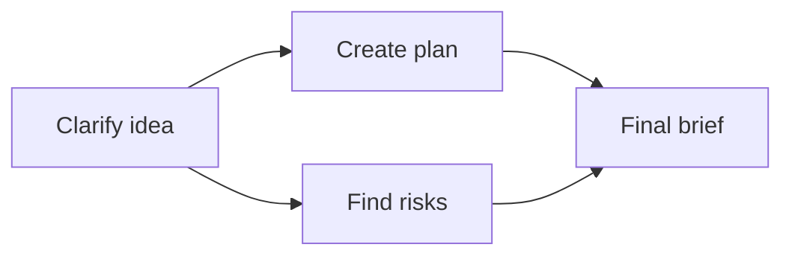

# How OpenFlow works

Each agent gets a conversation and a job. Work with one in a direct chat, or connect several in a workflow so their results feed later steps.

## A graph describes the work

A node has a task prompt, model, and tool policy. An edge means the downstream node needs the upstream result. This feature-planning workflow clarifies a request, plans the work and checks risks independently, then combines the results:

Independent nodes in the same execution layer run together; a downstream node waits for its dependencies to finish. Each agent gets its prompt, shared context, and the input available to that step. Root nodes get your starting message. Downstream agents receive upstream output and can read saved handoff artifacts for detail. The [workflow and run definitions](workflows-and-runs.md) separate the saved graph from each execution of it.

## During a run

Open a node's conversation to follow its work. The agent may call a tool, ask you a question, or produce final output; its approval mode decides which tool calls need your decision. Answer or approve there. Other ready nodes keep working while one waits.

A failed node can await retry while the run stays active. [Runs and recovery](../guides/runs.md) covers replying, retrying a node, continuing an inactive session, and resuming a saved checkpoint.

## Saved work and new runs

The workflow stores the graph and agent configuration; each run stores its own history and workflow snapshot. Editing a workflow doesn't rewrite earlier runs. History opens a read-only replay. Paused, stopped, or failed runs can resume when a recoverable checkpoint exists; completed workflow runs are replay-only.

After success, **Run review** may suggest changes to prompts, tools, models, coordination, or the graph. It's advisory and doesn't change whether the workflow run succeeded.

## Plan → Execute mode

Enable **Plan → Execute** in workflow settings when execution should follow a reviewed plan.

1. During **Planning**, the designated evidence-source node prepares a plan with restricted tools.
2. Sealing the plan always needs explicit approval, even when other tool calls are auto-approved. A denial leaves the draft editable.
3. After approval and a valid evidence packet, the run enters **Execution** and later agents receive the frozen packet.

Without this setting, normal tool rules apply. The [Plan → Execute protocol](../architecture/plan-execute.md) defines permitted writes, artifact sealing, and evidence fields.

For implementation details, see [Runtime architecture](../architecture/end-to-end-runtime.md) and the [architecture contract](../architecture/contract.md).
