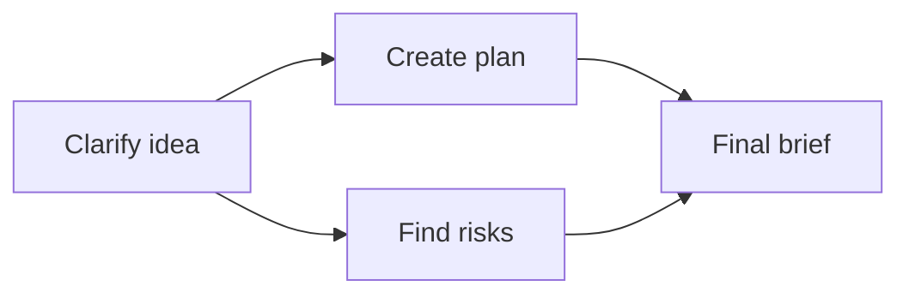

# How OpenFlow works

OpenFlow gives each agent a conversation and a job. You can work with one agent in a direct chat, or connect several agents in a workflow so their results feed later steps.

## A graph describes the work

Each node has a task prompt, model, and tool policy. An edge means that the downstream node needs the upstream result. For example, the feature-planning workflow clarifies a request, plans the work and checks risks independently, then combines the results:

Independent nodes in the same execution layer run together. A downstream node waits for its dependencies to finish. Each agent receives its prompt, shared context, and the input available to that step; root nodes receive your starting message.

A downstream agent receives upstream output and can read saved handoff artifacts for more detail. The [workflow and run definitions](workflows-and-runs.md) distinguish the graph you save from each execution of it.

## During a run

Open a node’s conversation to follow its work. An agent may call a tool, ask you a question, or produce its final output. Its approval mode determines which tool calls need your decision. Answer or approve in that conversation; other ready nodes can keep working while one waits.

A failed node can await retry while the run remains active. Use [Runs and recovery](../guides/runs.md) to choose between replying, retrying a node, continuing an inactive session, and resuming a saved checkpoint.

## Saved work and new runs

The workflow stores the graph and agent configuration. Each run stores its own history and workflow snapshot. Editing a workflow does not rewrite an earlier run. History can open a read-only replay; paused, stopped, or failed runs can resume when a recoverable checkpoint exists. Completed workflow runs are replay-only.

After success, **Run review** may suggest changes to prompts, tools, models, coordination, or the graph. The review is advisory. Its result does not change whether the workflow run succeeded.

## Plan → Execute mode

Enable **Plan → Execute** in workflow settings when execution should follow a reviewed plan. The designated evidence-source node prepares a plan during **Planning**, with restricted tools. Sealing that plan always asks for explicit approval, even when other tool calls are auto-approved.

A denial leaves the draft editable. After approval and a valid evidence packet, the run enters **Execution** and later agents receive the frozen packet. Workflows without this setting use normal tool rules. The [Plan → Execute protocol](../architecture/plan-execute.md) defines the permitted writes, artifact sealing, and evidence fields.

For implementation details, use [Runtime architecture](../architecture/end-to-end-runtime.md) and the [architecture contract](../architecture/contract.md).
