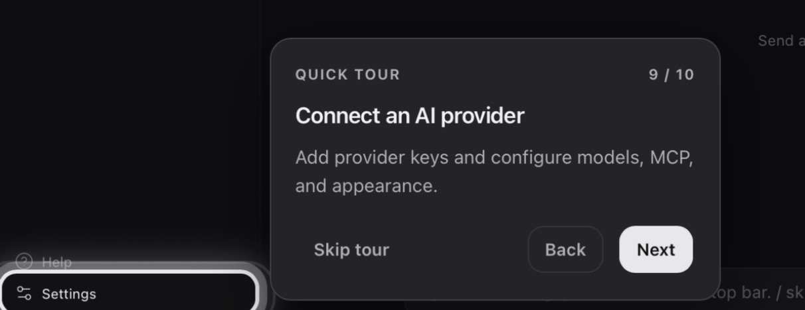

# Install OpenFlow

The macOS release needs no Rust or Node. For a development checkout, see [Build from source](build-from-source.md).

## Install the macOS release

1. Download the latest macOS build from [GitHub Releases](https://github.com/philbotar/OpenFlow/releases/latest).
2. Open the `.dmg`, drag **OpenFlow** to **Applications**, and open the app.

If macOS blocks it, right-click **OpenFlow** → **Open**, or run `xattr -cr /path/to/OpenFlow.app` on the `.app` bundle.

## First launch

A quick tour opens and points out the main controls. Its **Connect an AI provider** step highlights **Settings**. Select **Done** to close the tour, then open **Settings → Providers** and follow [Provider setup](../guides/provider-setup.md). **Help** replays the tour.

<figure class="product-shot product-shot--detail" style="--shot-width: 606px">

<figcaption>The tour’s <strong>Connect an AI provider</strong> step highlights <strong>Settings</strong>.</figcaption>
</figure>

## Update or reinstall

Stop any active workflow or chat run, then select **Update now** in **Settings → About**. If an update is published, OpenFlow downloads it, installs it, and relaunches. Otherwise the button reports that the app is current or that the update failed.

In-app updates work only in the packaged macOS app. For a development build or a failed update, install the latest build from [GitHub Releases](https://github.com/philbotar/OpenFlow/releases/latest) by hand.

Development requirements and installer commands: [Build from source](build-from-source.md).
