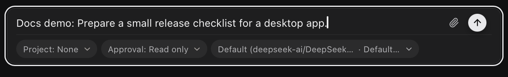

# Direct chats

A direct chat is a saved conversation with a model. You can create and browse chats before [connecting a provider](provider-setup.md), but sending a message needs a ready one.

## Start or restore a chat

1. Select **New chat**.
2. Choose the [project](projects-and-persistence.md) that owns the chat, or leave it empty for an isolated app-managed workspace. Choose before sending: the first message creates a saved run and locks the project. To use a different project, start a new chat.
3. Send a request such as “Prepare a small release checklist for a desktop app.” The reply appears in the conversation.

Model, speed, approval mode, reasoning effort, and skills are available when the selected provider supports them.

<figure class="product-shot product-shot--detail" style="--shot-width: 625px">

<figcaption>Prepared, not sent. Project and runtime settings sit below the message; the paperclip attaches files and the upward arrow sends. Select the image for the complete window.</figcaption>
</figure>

OpenFlow names the chat from its first message. To continue, select it under **Chats** to reopen the transcript, then send another message in the same run. A project chat uses that project's configured execution folder and `.flow/runs/` storage.

To remove a chat, stop its active run, then choose **Delete chat** from its row menu.

## Attach files

Use the paperclip, paste an image, or drop files on the composer. A message takes at most four files: up to 10 MiB each and 25 MiB total. Supported formats: JPEG, PNG, GIF, WebP, PDF, TXT, Markdown, CSV, JSON, HTML, CSS, JavaScript, and Python.

OpenFlow validates each file, copies it into the run-owned attachment directory, and sends that managed copy to the provider. The original path isn't part of the checkpoint. Image previews are bounded local derivatives. Documents appear as metadata cards, never as active HTML or scripts.

If a file is rejected, remove it, or export it to a supported format and retry. A provider or model may still reject an accepted media type; if so, choose a model that supports it. For missing files, corrupt copies, or preview errors, see [Chat attachments](../troubleshooting/README.md#chat-attachments).

## Continue a conversation

Each assistant turn ends after a normal reply. If the assistant asks for a choice, answer the card or type in the composer. The same [run controls](runs.md) handle questions, approvals, and recovery. Chats are listed under **Chats** in the sidebar, apart from the workflow catalog and canvas.

## Recover a failed turn

For an active failed turn, use **Retry** or send a correction. If the error is model-specific, change the model first. Retry keeps the chat's run, transcript, and attachments.

Opening an active chat keeps its pending question or approval; answer it in the conversation. [Runs and recovery](runs.md#retry-a-failed-or-interrupted-node) lists which settings can change before retry.

## Data and cleanup

Deleting a chat removes its history and run-owned copies. If filesystem cleanup can't finish right away, OpenFlow records it as pending and retries later. See [Security and data](../security-and-data.md) for data boundaries and the [persistence reference](../reference/README.md#runtime-and-persistence-paths) for chat and attachment storage locations.
