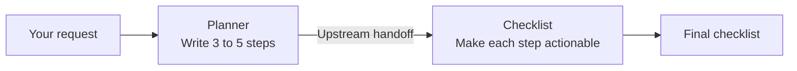
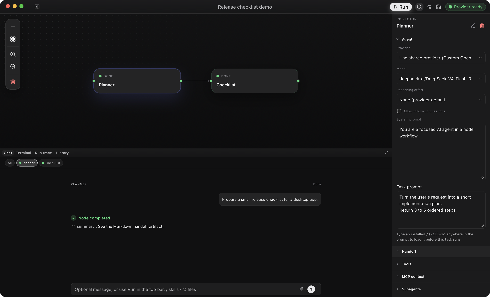
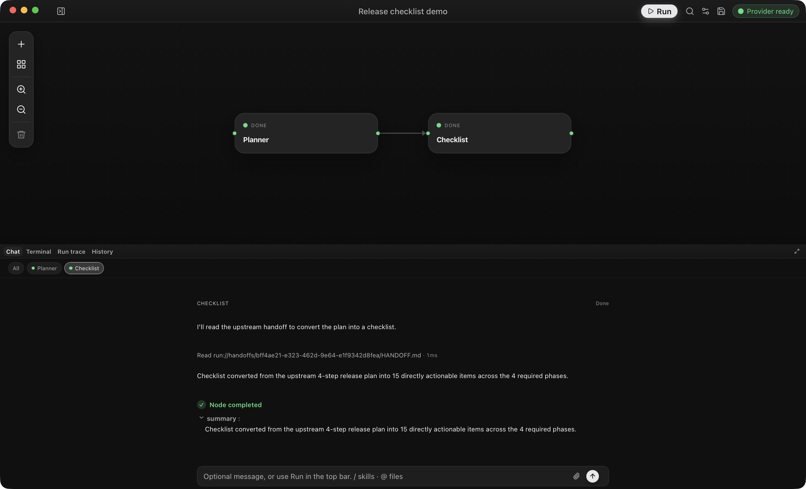

# Your first workflow

<a id="first-workflow-walkthrough"></a>

Connect a planner to a checklist agent, then give them a release task. You need a ready model provider; this example uses no repository or MCP tool.



The connection makes `Checklist` wait for `Planner`. You can read both conversations after the run.

<div class="doc-steps">
<div class="doc-step">

## 1. Open OpenFlow

Open the [installed app](../getting-started/README.md) or your [development build](../getting-started/build-from-source.md). In **Settings → Providers**, confirm the active provider is ready. If it is not, follow [Provider setup](provider-setup.md) or [Provider not ready](../troubleshooting/README.md#provider-not-ready).

</div>
<div class="doc-step">

## 2. Create and name the workflow

1. Select **New workflow** in the sidebar.
2. Select **Create new workflow**.
3. Open the new workflow's row menu and select **Rename**.
4. Enter `Release checklist demo`, then press Enter.

OpenFlow creates app workflows in its local data directory. To store this example in a repository instead, use **New workflow** from that project's row. [Projects and persistence](projects-and-persistence.md) explains where OpenFlow stores each kind of workflow.

</div>
<div class="doc-step">

## 3. Add the Planner node

1. Select the `Idea` node that OpenFlow creates with a new workflow.
2. In the Inspector header, select the pencil button (**Rename Idea**) and enter `Planner`.
3. Paste this text into **Task prompt**:

```text
Turn the user's request into a short implementation plan.
Return 3 to 5 ordered steps.
```

<figure class="product-shot product-shot--inspector">

[](../public/media/screenshots/release-checklist-inspector.png)

<figcaption>This saved example has already run. The Inspector edits the selected node. Put the task in <strong>Task prompt</strong>, below the system prompt. Select any screenshot to open it at full size.</figcaption>
</figure>

Keep the default **Approval mode**. This example does not ask the node to use a repository or external tool.

</div>
<div class="doc-step">

## 4. Add and connect the Checklist node

Select **Add node → Blank agent node**, rename the new node `Checklist`, and paste this text into **Task prompt**:

```text
Convert the upstream plan into a checklist.
Each item should be directly actionable.
```

Drag from the output handle on `Planner` to the input handle on `Checklist`. The arrow must point from `Planner` to `Checklist`.


Select **Save workflow** in the top bar. A **Saved** notification confirms that the graph and prompts were persisted.

</div>
<div class="doc-step">

## 5. Start the workflow with a message

Open the **Chat** dock and enter:

```text
Prepare a small release checklist for a desktop app.
```

Select **Start workflow** in the composer and check the result:

1. `Planner` receives the starter message and produces the plan.
2. `Checklist` receives the upstream handoff and produces a checklist.
3. Both nodes complete, and the run status becomes `completed`.

<figure class="product-shot">

[](../public/media/screenshots/release-checklist-run.png)

<figcaption>Both nodes are Done, with Checklist’s conversation selected. This run shows a completion summary; your model’s wording may differ.</figcaption>
</figure>

Use the `Planner` and `Checklist` filters to inspect each conversation. A Markdown handoff may appear as a completion summary rather than its full contents. Expand a downstream **Read** tool entry to inspect the upstream handoff it used. **Run trace** shows the execution events; **History** keeps the run for replay. If the graph does not start, use [Workflow validation and authoring](../troubleshooting/README.md#workflow-validation-and-authoring).

</div>
</div>

<a id="add-tools-or-reuse-agents"></a>

Both nodes now have a result, and the run is saved in **History**. Send a different request to start another run of the same workflow. To extend the graph, use [Workflow authoring](workflow-authoring.md); to add tools or callable agents, use [Tools and integrations](tools-and-integrations.md).
