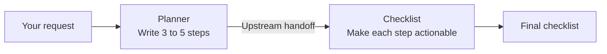
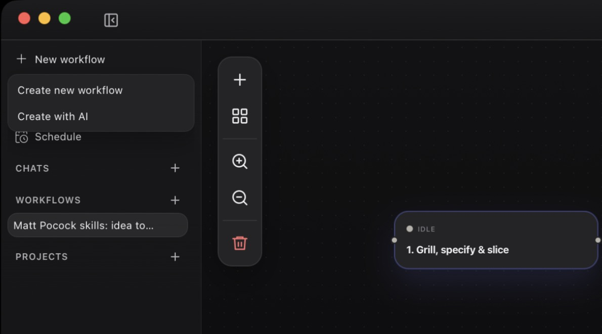
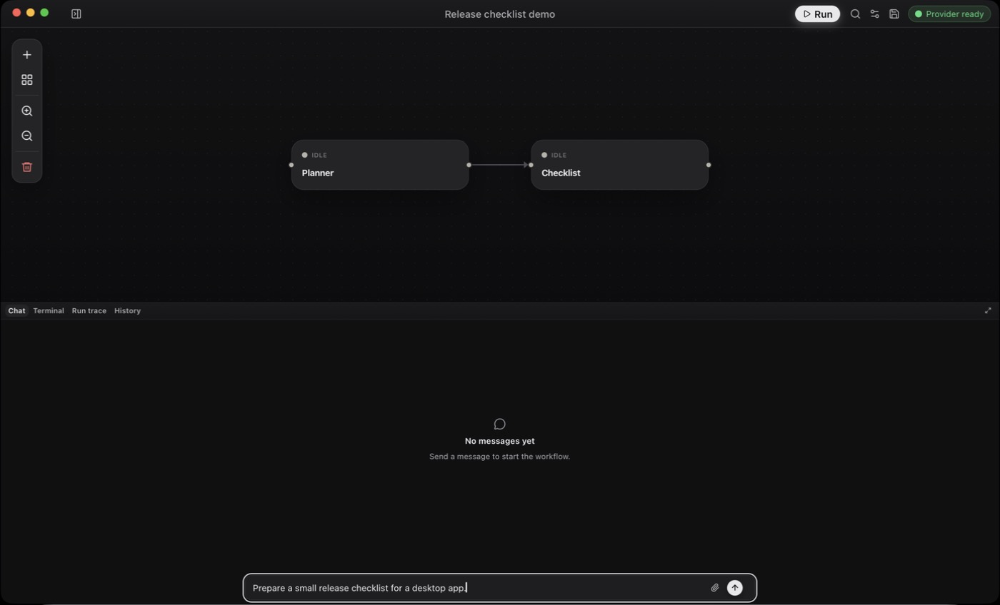

# Your first workflow

<a id="first-workflow-walkthrough"></a>

Connect a planner to a checklist agent and give them a release task. You need a ready model provider; no repository or MCP tool is used.



The connection makes `Checklist` wait for `Planner`. Afterwards you can read both conversations.

<div class="doc-steps">
<div class="doc-step">

## 1. Open OpenFlow

Open the [installed app](../getting-started/README.md) or your [development build](../getting-started/build-from-source.md). Confirm the active provider is ready in **Settings → Providers**. If not, see [Provider setup](provider-setup.md) or [Provider not ready](../troubleshooting/README.md#provider-not-ready).

</div>
<div class="doc-step">

## 2. Create and name the workflow

1. In the sidebar, select **New workflow**, then **Create new workflow**.
2. From the workflow's row menu, select **Rename**, enter `Release checklist demo`, and press Enter.

<figure class="product-shot product-shot--detail" style="--shot-width: 595px">

[](../public/media/screenshots/first-workflow-new-workflow-menu.jpg)

<figcaption><strong>New workflow</strong> opens this menu. Choose <strong>Create new workflow</strong>.</figcaption>
</figure>

This is an app workflow, stored in OpenFlow's local data directory. To store it in a repository, use **New workflow** on that project's row instead. [Projects and persistence](projects-and-persistence.md) explains where each kind is stored.

</div>
<div class="doc-step">

## 3. Add the Planner node

1. Select the `Idea` node that every new workflow starts with.
2. In the Inspector header, select the pencil (**Rename Idea**) and enter `Planner`.
3. Paste into **Task prompt**:

   ```text
   Turn the user's request into a short implementation plan.
   Return 3 to 5 ordered steps.
   ```

<figure class="product-shot product-shot--inspector">

[](../public/media/screenshots/release-checklist-inspector.png)

<figcaption>A saved example that has already run. The Inspector edits the selected node; <strong>Task prompt</strong> is below the system prompt. Select any screenshot for full size.</figcaption>
</figure>

Leave **Approval mode** at its default; this node uses no repository or external tool.

</div>
<div class="doc-step">

## 4. Add and connect the Checklist node

1. Select **Add node → Blank agent node** and rename the new node `Checklist`.
2. Paste into **Task prompt**:

   ```text
   Convert the upstream plan into a checklist.
   Each item should be directly actionable.
   ```

3. Drag from the output handle on `Planner` to the input handle on `Checklist`. The arrow must point from `Planner` to `Checklist`.
4. Select **Save workflow** in the top bar. A **Saved** notification confirms the graph and prompts were saved.

<figure class="product-shot">

[](../public/media/screenshots/first-workflow-ready-to-start.jpg)

<figcaption>Ready to run: the arrow points from <code>Planner</code> to <code>Checklist</code>, and the request is typed in the composer.</figcaption>
</figure>

</div>
<div class="doc-step">

## 5. Start the workflow with a message

1. In the **Chat** dock, enter:

   ```text
   Prepare a small release checklist for a desktop app.
   ```

2. Select **Start workflow** in the composer.

`Planner` turns the starter message into a plan. `Checklist` then turns the upstream handoff into a checklist. When both nodes complete, the run status is `completed`.

<figure class="product-shot">

[](../public/media/screenshots/release-checklist-run.png)

<figcaption>Both nodes are Done, with Checklist’s conversation selected, showing a completion summary. Your model’s wording may differ.</figcaption>
</figure>

- Use the `Planner` and `Checklist` filters to read each conversation.
- A Markdown handoff may appear only as a completion summary. Expand a downstream **Read** tool entry to see the upstream handoff it used.
- **Run trace** shows execution events; **History** keeps the run for replay.

If the graph doesn't start, see [Workflow validation and authoring](../troubleshooting/README.md#workflow-validation-and-authoring).

</div>
</div>

<a id="add-tools-or-reuse-agents"></a>

The run is saved in **History**. Send a different request to run the same workflow again. To extend the graph, see [Workflow authoring](workflow-authoring.md); to add tools or callable agents, see [Tools and integrations](tools-and-integrations.md).
