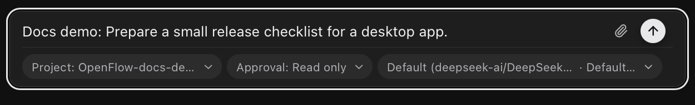

# Projects and persistence

A project is a registered repository folder that keeps its workflows, run metadata, and attachments together. Its workflows and [direct chats](direct-chats.md) do file operations in its execution folder, so choose a folder you're willing to expose to file tools and MCP roots. See [Security and data](../security-and-data.md) for those boundaries.

Registering doesn't copy the repository. It creates `{project}/.flow/` and tests write access with a temporary create, write, rename, and delete probe.

## Add and remove a project

Select `+` on the **Projects** heading, or **Add Project…** in a project selector, then pick the folder in the native **Select project folder** dialog. The execution directory defaults to that folder.

To unregister, choose **Remove project** from its row menu and confirm. Removal is blocked while a project run is active. The repository, workflow files, and other `.flow` files stay on disk.

## Project workflows

Project workflows live at:

```text
{project}/.flow/workflows/{workflowId}.workflow.json
```

Create one with **New workflow** or **Create with AI** on a project row. **Copy from…** makes an independent project copy of an existing workflow, with a new workflow ID and a name ending in `copy`; it doesn't sync with the source.

The catalog merges project and app workflows on load. If both have the same workflow ID, the project file wins.

## Run locations

For a chat, choose the project in the new chat's **Project** control before sending the first message.

<figure class="product-shot product-shot--detail" style="--shot-width: 625px">

[](../public/media/screenshots/project-chat-prepared.png)

<figcaption>The selected project appears below the message. This demo request is unsent, so the project can still change. Select the image for the full window.</figcaption>
</figure>

Project workflow and chat runs use the project's configured execution directory, or its root if none is set. Run metadata goes under:

```text
{project}/.flow/runs/{runId}/
```

OpenFlow probes that `.flow` is writable before a project run continues. App workflows and chats without a project use isolated app-managed folders, listed in [Runtime and persistence paths](../reference/README.md#runtime-and-persistence-paths). For resuming stored work, see [Runs and recovery](runs.md); for chat project selection, see [Start or restore a chat](direct-chats.md#start-or-restore-a-chat).

## What remains on disk

- Deleting a workflow permanently removes its app record and every linked project workflow file. Its durable run directories stay.
- Deleting a chat removes its metadata, then quarantines and deletes its run directory, including run-owned attachment copies. If cleanup can't finish, OpenFlow reports pending cleanup and retries later.

Don't hand-edit `projects.json`, `workflows.json`, `chats.json`, or run checkpoints while the app is running.
