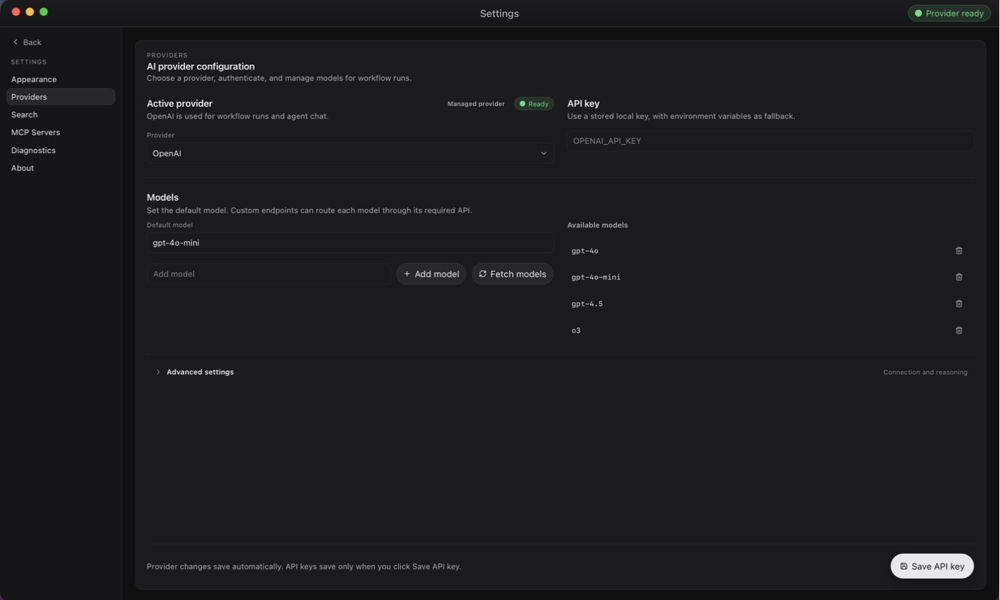
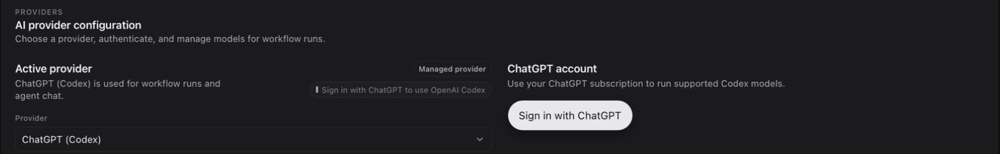
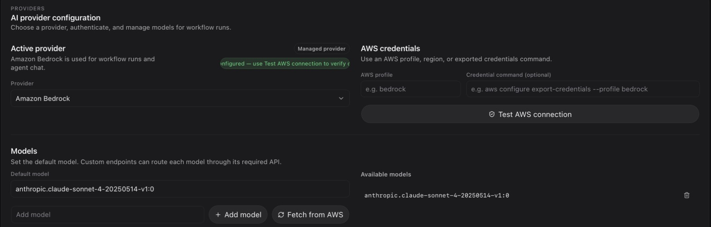

# Provider setup

A provider is the model service OpenFlow calls for runs, chats, and AI-assisted workflow editing. Connect one in **Settings → Providers**. **Run** stays disabled until the provider shows **Ready**.

On first launch, the quick tour's **Connect an AI provider** step points to **Settings** in the sidebar.

## Connect a provider

1. Open **Settings → Providers** and pick one from the **Provider** dropdown.
2. Authenticate it using the section below.
3. Check that the status chip says **Ready**.

<figure class="product-shot">

<figcaption><strong>Settings → Providers</strong> with OpenAI active. The chip reads <strong>Ready</strong> once the configuration resolves.</figcaption>
</figure>

Profile changes save automatically. Only API keys need an explicit **Save API key**. The active provider is the default for chats and for workflows that don't choose their own.

## Without a provider

You can still create workflows, edit nodes, and save graphs. **Run**, **Create with AI**, and other model-backed actions stay disabled until the provider is ready.

## Authenticate

### API key

Applies to **OpenAI**, **Anthropic**, **OpenRouter**, and other hosted providers.

1. Paste your key into the **API key** panel.
2. Select **Save API key**.

The key is stored in plain text in the local `settings.json`. If you'd rather not save it, set the provider's environment variable (such as `OPENAI_API_KEY` or `ANTHROPIC_API_KEY`) before launching OpenFlow. [Provider profiles](../reference/providers.md#provider-key-resolution) lists the variables and which source wins.

### ChatGPT (Codex)

1. Select **ChatGPT (Codex)** as the provider.
2. Select **Sign in with ChatGPT** and finish in the browser.

<figure class="product-shot">

<figcaption>With <strong>ChatGPT (Codex)</strong> selected, sign in from the <strong>ChatGPT account</strong> panel.</figcaption>
</figure>

If port 1455 is busy, OpenFlow offers a device code instead. Use **Disconnect** to sign out. Usage bills to your ChatGPT plan, not to an API account, and `OPENAI_API_KEY` is not used. If sign-in fails, see [ChatGPT (Codex) sign-in](../troubleshooting/README.md#chatgpt-codex-sign-in).

### Amazon Bedrock

1. Select **Amazon Bedrock**.
2. Set **AWS profile** (or an optional **Credential command**) and, under **Advanced settings**, **AWS region**. Or leave them to pick up `AWS_PROFILE` and `AWS_REGION` from your environment.
3. Select **Test AWS connection**. Until you do, Bedrock only reports that the region is configured; it hasn't checked your credentials.
4. Optionally select **Fetch from AWS** and choose which models to expose.

<figure class="product-shot">

<figcaption>Bedrock reports the region as configured until <strong>Test AWS connection</strong> checks your credentials.</figcaption>
</figure>

For SSO credentials, see [Bedrock with SSO](../architecture/provider-adapters.md#bedrock-with-sso).

### Local and custom endpoints

- **Ollama local** and **LM Studio local**: start the local server first. No key needed.
- **Custom OpenAI-compatible API**: set **API base URL**. Leave the key empty for a trusted endpoint with no auth.

## Choose models per workflow

The active provider supplies models by default. To change that:

- Set a shared provider in **Workflow settings**.
- Override it for one node with **Provider** in that node's **Inspector**.

The most specific choice wins: node, then workflow, then active provider.

Under **Settings → Providers**, **Fetch models** lists what the provider offers, and you can add a model ID it doesn't return. On custom OpenAI-compatible profiles you can set each model's API type (Responses, Chat Completions, or Anthropic Messages). Providers that support extended thinking also let you set a default reasoning effort.

## Verify

1. Check that **Settings → Providers** says **Ready**.
2. Open **New chat** and send a short message. A reply confirms the provider accepts requests. **Ready** only means the configuration is complete.

If it still isn't ready, see [Provider not ready](../troubleshooting/README.md#provider-not-ready). Otherwise, [start a direct chat](direct-chats.md) or [build your first workflow](first-workflow.md).

For default endpoints and wire APIs, see [Provider profiles](../reference/providers.md). Web search and MCP use [separate settings](tools-and-integrations.md). For how requests are routed, see [Request routing](../architecture/provider-adapters.md#request-routing).
