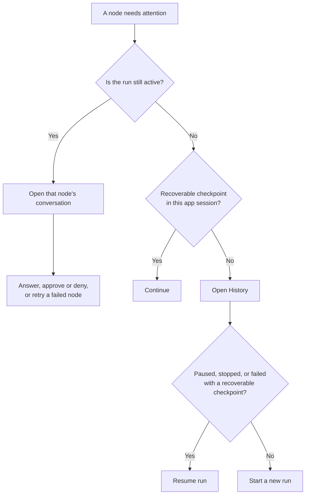
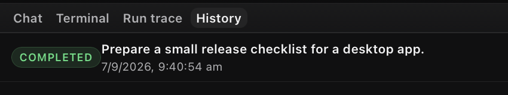

# Runs and recovery

When a node waits for an answer, approval, or retry, respond in its conversation; the rest of the run keeps going. **Continue** and **Resume run** only recover inactive runs.

## Start a run

Open the workflow in the [editor](using-the-app.md) and select **Run**. It's enabled once the provider is ready and no run is continuable. If the workflow expects entrypoint input, send starter text in the composer. A [project run](projects-and-persistence.md) also needs write access to its `.flow` directory.

At start, OpenFlow snapshots the [workflow](workflow-authoring.md), resolves providers, validates the project execution location, and records a durable run. Nodes in the same ready execution layer can run concurrently. A node can finish, request human input, request tool approval, retry a transient failure, or fail.

## Continue, approve, or stop

- **Answer** in the composer or structured question card. Submitting resumes the run.
- **Approve or deny** a tool call in the conversation; either resumes the run. A denial returns to the model as a tool result, so it may recover.
- **Continue** appears only when the selected workflow run is inactive and this app session still holds a recoverable checkpoint. It resumes that checkpoint.
- **Stop** cancels the selected run only, not other active chats or workflows.

Run statuses are `running`, `paused`, `stopped`, `completed`, and `failed`. Durable checkpoints record events such as start, awaiting input, awaiting approval, retry, user stop, completion, or failure. Node status is separate; see [Workflows and runs](../concepts/workflows-and-runs.md).

## Retry a failed or interrupted node

While a workflow run is active, a failed or interrupted node can show **Retry** in its conversation; a direct chat shows it on an active failed turn. Select it to retry without adding a message, or send a correction in that node's composer. With several nodes waiting, select the right one first.

To switch models before retrying, use the node's **Inspector** (workflow) or the composer controls (direct chat). You can change model, reasoning effort/budget, approval mode, and speed at runtime. Changes apply to later requests, not one in flight. Retry continues the same run and keeps its transcript and attachments.

[Run settings](../reference/configuration.md#run-settings) lists recorded run fields and recoverable statuses.

## Review and replay

In **History** for the active workflow, choose a run. **Open replay** is read-only, built from the stored workflow snapshot and immutable run context, including selected MCP context and node handoff artifacts.

<figure class="product-shot product-shot--detail" style="--shot-width: 425px">

<figcaption>History shows this tutorial run as Completed, with Open replay at the far right of the full window. Completed doesn't prove output quality; inspect the conversation and handoffs. Select the image for the full window.</figcaption>
</figure>

**Resume run** continues a `paused`, `stopped`, or `failed` run from its latest recoverable checkpoint. Workflow resume starts from the saved snapshot: it refreshes supported runtime settings from the current workflow and keeps the saved graph, prompts, outputs, and transcript. To execute graph or prompt edits, start a new run. Resumed direct chats refresh their chat config and built-in conversation instructions.

Completed workflow runs may show **Run review** suggestions from a separate model pass. They don't change the run's success status. If the review fails, the run stays complete and the UI reports the review error.

## Handoffs and file changes

Downstream nodes get compact upstream output and can read immutable Markdown or JSON handoff artifacts through the run reference. The run trace records node and tool events.

File edits show a collapsed change summary; **View diff** opens the stored diff when available. Bash, external-tool, and MCP writes may carry an attribution warning.

## When a run will not continue

Check provider readiness, pending approvals or input, project `.flow` write access, and the run's latest History status. If a provider or MCP server is unavailable, read the system message before retrying. Then use the recovery action from the diagram above; if neither **Continue** nor **Resume run** is available, start a new run. [Troubleshooting](../troubleshooting/README.md) lists specific errors and fixes.
