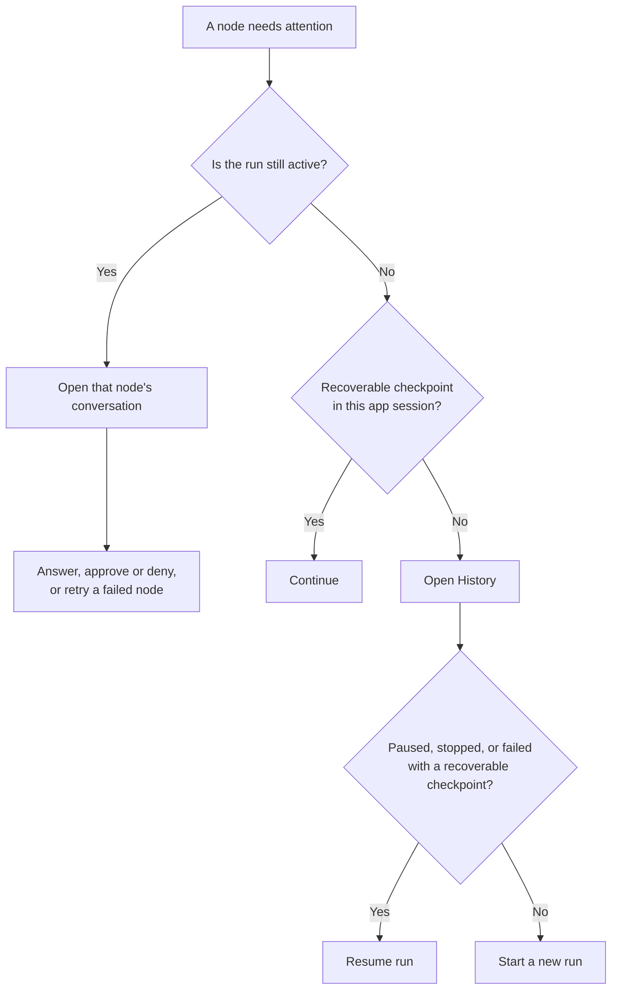

# Runs and recovery

A run can keep working while one node waits for an answer, approval, or retry. Use that node's conversation to respond. **Continue** and **Resume run** recover inactive runs; they are not required for active questions or approvals.

## Start a run

Open the workflow in the [editor](using-the-app.md), then select **Run** when the provider is ready and there is no continuable run. Send starter text through the composer when the workflow expects entrypoint input. A [project run](projects-and-persistence.md) also needs write access to its `.flow` directory.

At run start, OpenFlow snapshots the [workflow](workflow-authoring.md), resolves providers, validates the project execution location, and records a durable run.

Nodes in the same ready execution layer can run concurrently. A node can finish, request human input, request tool approval, retry a transient failure, or fail. Tool calls that need approval appear in the node conversation.

## Continue, approve, or stop

- Answer a question in the composer or structured question card. Submitting the answer resumes that active run; no separate **Continue** action is required.
- Approve or deny a tool call in the conversation. The decision resumes that active run. A denial is returned to the model as a tool result, so the model may recover.
- **Continue** appears only when the selected workflow run is inactive and the current app session still holds a recoverable checkpoint. It resumes that in-session checkpoint.
- **Stop** cancels the selected run. It does not stop other active chats or workflows.

Run statuses are `running`, `paused`, `stopped`, `completed`, and `failed`. A durable checkpoint records events such as start, awaiting input, awaiting approval, retry, user stop, completion, or failure. [Workflows and runs](../concepts/workflows-and-runs.md) distinguishes run status from node status.

## Retry a failed or interrupted node

While a workflow run remains active, a failed or interrupted node can show **Retry** in its conversation. Direct chats show **Retry** for an active failed turn. Select it to retry without adding a message, or send a correction through that node's composer. When several nodes need attention, select the intended node before sending the correction.

If the error requires a different model, change the model before retrying: use the node's **Inspector** for a workflow, or the composer controls for a direct chat. Supported runtime changes include model, reasoning effort/budget, approval mode, and speed. They affect subsequent requests; they do not rewrite a request already in flight. Retry continues the same run and retains its transcript and attachments.

For an inactive run, use **Continue** if the current app session has a recoverable checkpoint, or **Resume run** from History when offered. [Run settings](../reference/configuration.md#run-settings) lists the recorded run fields and recoverable statuses.

## Review and replay

Open **History** for the active workflow and choose a run. **Open replay** is read-only and uses the stored workflow snapshot and immutable run context.

<figure class="product-shot product-shot--detail" style="--shot-width: 425px">

<figcaption>History records this earlier tutorial run as Completed. Its row offers Open replay at the far right of the complete window. Completion status alone does not establish output quality; inspect the conversation and handoffs. Select the image for the complete window.</figcaption>
</figure>

The stored context includes selected MCP context and node handoff artifacts. For a `paused`, `stopped`, or `failed` run, **Resume run** continues from the latest recoverable checkpoint.

Durable workflow resume starts from the saved workflow snapshot. It refreshes supported runtime settings from the current workflow, while preserving the saved graph, prompts, outputs, and transcript. Start a new workflow run to execute graph or prompt edits. Direct chats refresh their chat config and built-in conversation instructions when resumed.

Completed workflow runs may show **Run review** suggestions. The review is a separate model pass and does not change the run's success status. If the review fails, the run itself remains complete and the UI reports the review error.

## Handoffs and file changes

Downstream nodes receive compact upstream output and can read immutable Markdown or JSON handoff artifacts through the run reference. The run trace records node and tool events.

File edits show a collapsed change summary; **View diff** opens the stored diff when available. Bash, external tools, and MCP writes may carry an attribution warning.

## When a run will not continue

Check provider readiness, pending approvals or input, project `.flow` write access, and the run's latest History status. If a provider or MCP server is unavailable, read the system message before retrying.

After fixing the cause, use the recovery action shown in the diagram above. If neither **Continue** nor **Resume run** is available, start a new run. [Troubleshooting](../troubleshooting/README.md) lists specific errors and fixes.
