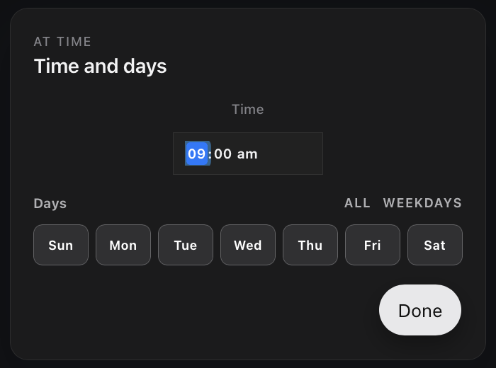

# Scheduling workflows

Keep OpenFlow open for scheduled workflows to run. The scheduler runs inside the desktop app and cannot start it for you.

[Save the workflow](workflow-authoring.md), make its provider ready, and confirm its [project execution folder](projects-and-persistence.md) is writable before adding a schedule.

## Create a schedule

Select **Schedule** in the sidebar, then **Add workflow**. Choose a workflow and a schedule type:

- For a timed schedule, select **At time**, then the time summary (initially **Daily at 09:00**) to open **Time and days**.
- For an interval schedule, select **Repeat**, then set **Every** with minutes, hours, or days.

<figure class="product-shot product-shot--detail" style="--shot-width: 350px">

<figcaption>Set the time and days, then select Done and save the schedule row. This dialog was captured for a disabled demo schedule; no scheduled run was started. Select the image for the full-resolution dialog.</figcaption>
</figure>

Use the row's On/Off control to enable or disable a schedule. The row shows **Next** and **Last** run information. Save the schedule or use the trash action to remove it.

Timed schedules start at 09:00 with all days selected; interval schedules start at 30 minutes. The [schedule limits](../reference/configuration.md#schedules) are 1 to 59 minutes, 1 to 23 hours, or 1 to 31 days.

Selecting **Add workflow** immediately saves the 09:00 default in your system's local IANA timezone. Editing and saving a timed or interval preset stores the generated schedule in UTC. Check the row's local **Next** time after every save.

## Scheduled run behavior

Scheduled runs use the same runtime, provider routing, approvals, tools, project execution directory, and durable storage as manual runs. Configure entrypoint behavior before enabling the schedule.

A scheduled run can pause for human input or tool approval. Open the workflow and inspect the run in **History**.

If the run is active, answer in its conversation. If it is inactive and **Resume run** is offered, resume it from **History**.

After reopening OpenFlow, check **Next** and **Last** once the app has loaded.

## Troubleshoot a schedule

If a schedule does not fire, confirm the row is On, the workflow exists, the provider is ready, the app is running, and the project `.flow` directory is writable.

For a run that started but paused or failed, use [Runs and recovery](runs.md).
