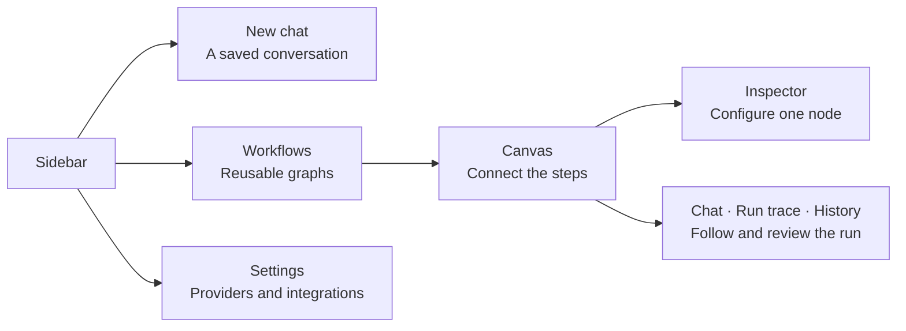

# Using the app

Start a chat or open a workflow from the sidebar. Projects group work by repository; Settings holds provider and integration setup.

## Main navigation

| Area | What it does |
| --- | --- |
| **New chat** | Starts a saved [direct chat](direct-chats.md) without creating a workflow. |
| **Agents** | Manages saved agent definitions for use as [callable agents](tools-and-integrations.md#saved-and-callable-agents). |
| **Schedule** | Adds a [timed or interval schedule](scheduling.md) to an existing workflow. |
| **Workflows** | Lists app-level workflows. Use **New workflow** to create one, or its row menu to rename or delete it. |
| **Projects** | Registers repository folders and shows [project-local workflows](projects-and-persistence.md). |
| **Help** | Replays the guided tour. **Next**, **Back**, **Skip tour**, and Escape control the tour. |
| **Settings** | Contains Appearance, Providers, Search, MCP Servers, Diagnostics, and About. |

The **Chats**, **Workflows**, and **Projects** headings keep their `+` actions visible. A project row menu contains **New workflow**, **Create with AI**, **Copy from…**, and **Remove project**.

## Common screens

[Direct chats](direct-chats.md) use a full-page composer and have durable run history. They do not appear in the workflow catalog or canvas.

The [workflow editor](workflow-authoring.md) contains the Canvas, Inspector, Workflow Settings, and a bottom dock with **Chat**, **Terminal**, **Run trace**, and **History**. Use **Chat**, **Run trace**, and **History** for [conversation, inspection, and recovery](runs.md).

## Composer controls

Depending on the screen and provider, the composer can expose **Project**, **Model**, **Speed**, **Approval mode**, and **Reasoning effort**. `/` invokes a discovered skill and `@` references project files. Approval prompts appear in the conversation when a tool needs confirmation. The [configuration reference](../reference/configuration.md) lists limits and defaults.

## Provider readiness

The header shows **Provider ready** or **Connect provider**. A workflow can inherit the active provider, use a workflow provider, or override it on a node. Every provider referenced at run start must be ready. Follow [Provider setup](provider-setup.md) to connect one, or [Troubleshooting](../troubleshooting/README.md#provider-not-ready) if readiness fails.

## Workflow controls

| Capability | What you do in the app | Read |
| --- | --- | --- |
| Visual workflow editor | Add nodes on the canvas, connect edges, configure the inspector, fix validation errors before **Run** | [First workflow](first-workflow.md), [Using the app](using-the-app.md) |
| Parallel agent layers | Wire independent branches from the same upstream node; same-depth nodes run concurrently | [Workflows and runs](../concepts/workflows-and-runs.md#parallel-layers) |
| Multi-provider models | **Settings → Providers** for credentials; per-node model in the inspector | [Provider setup](provider-setup.md) |
| Tools (files, shell, search, …) | Inspector **Tools** → **Approval mode**; approve or deny in chat when prompted | [Tools reference](../reference/tools.md), [Tools and integrations](tools-and-integrations.md#approval-modes) |
| Subagents (callable agents) | **Agents** screen to save configs; inspector **Subagents** to attach them to a node | [Tools and integrations](tools-and-integrations.md#saved-and-callable-agents), [Callable agents](../architecture/callable-agents.md) |
| Interactive vs hands-off runs | Approval mode **Always ask** vs **Auto-approve all** on each node | [Tools and integrations](tools-and-integrations.md#approval-modes) |
| Project-aware workflows | **Projects** → add repo folder; workflows under `.flow/workflows/`; `@` file refs in chat | [Using the app](using-the-app.md), [Storage paths](../reference/README.md#runtime-and-persistence-paths) |
| Create with AI | Choose **Create with AI** to draft a graph from chat | [Workflow authoring](workflow-authoring.md#create-with-ai-safely) |
| Schedules | Sidebar **Schedule** on saved workflows | [Scheduling](scheduling.md) |
| Run history & resume | Dock **History** → replay or resume | [Runs and recovery](runs.md#review-and-replay), [Workflows and runs](../concepts/workflows-and-runs.md#run) |
| Post-run suggestions | After success, **Run review** in chat | [Workflows and runs](../concepts/workflows-and-runs.md#run) |
| Plan → Execute | Workflow settings → **Plan → Execute** | [Workflows and runs](../concepts/workflows-and-runs.md#plan--execute) |
| MCP servers | **Settings → MCP Servers** | [MCP servers](tools-and-integrations.md#mcp-servers) |
| Web search keys | **Settings → Search** (for search-cli during runs) | [Web search](tools-and-integrations.md#web-search) |
| Terminal in the dock | Dock **Terminal** tab | [App screens](using-the-app.md#common-screens) |

## Replay the guided tour

The in-app **Help** tour demonstrates **Create with AI**, node inspection, and **Run** / **Stop**.

<figure class="product-shot product-shot--detail" style="--shot-width: 555px">

<figcaption>Reopen the guided tour with Help at the bottom of the sidebar. Done closes its final step. Select the image for the full-resolution detail.</figcaption>
</figure>
