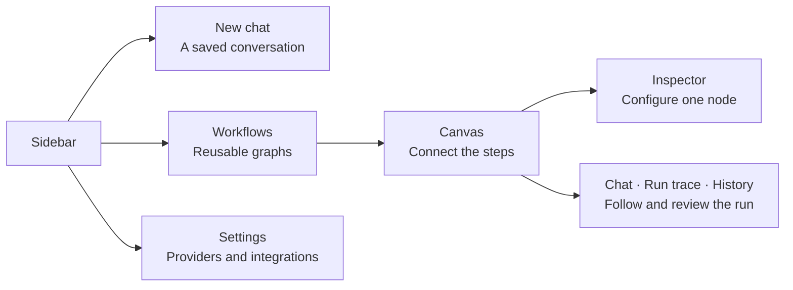
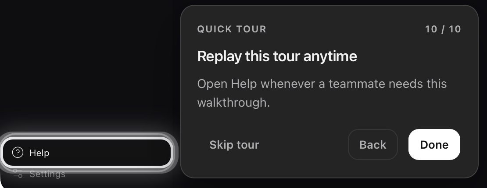

# Using the app

Start a chat or open a workflow from the sidebar. Projects group work by repository; Settings holds provider and integration setup.

## Main navigation

| Area | What it does |
| --- | --- |
| **New chat** | Starts a saved [direct chat](direct-chats.md), no workflow needed. |
| **Agents** | Saved agent definitions for [callable agents](tools-and-integrations.md#saved-and-callable-agents). |
| **Schedule** | Adds a [timed or interval schedule](scheduling.md) to an existing workflow. |
| **Workflows** | App-level workflows. **New workflow** creates one; the row menu renames or deletes it. |
| **Projects** | Registered repository folders and their [project-local workflows](projects-and-persistence.md). |
| **Help** | Replays the guided tour: **Next**, **Back**, **Skip tour**, or Escape. |
| **Settings** | Appearance, Providers, Search, MCP Servers, Diagnostics, and About. |

The **Chats**, **Workflows**, and **Projects** headings always show their `+` action. A project row menu has **New workflow**, **Create with AI**, **Copy from…**, and **Remove project**.

## Common screens

- [Direct chats](direct-chats.md): a full-page composer with durable run history. They don't appear in the workflow catalog or canvas.
- [Workflow editor](workflow-authoring.md): Canvas, Inspector, Workflow Settings, and a bottom dock with **Chat**, **Terminal**, **Run trace**, and **History**. **Chat**, **Run trace**, and **History** cover [conversation, inspection, and recovery](runs.md).

## Composer controls

Depending on screen and provider, the composer shows **Project**, **Model**, **Speed**, **Approval mode**, and **Reasoning effort**. Type `/` to invoke a discovered skill or `@` to reference project files. Approval prompts appear in the conversation when a tool needs confirmation. Limits and defaults: [configuration reference](../reference/configuration.md).

## Provider readiness

The header shows **Provider ready** or **Connect provider**. A workflow can inherit the active provider, use a workflow provider, or override it on a node. Every provider referenced at run start must be ready. To connect one, see [Provider setup](provider-setup.md); if readiness fails, see [Troubleshooting](../troubleshooting/README.md#provider-not-ready).

## Workflow controls

| Capability | What you do | Read |
| --- | --- | --- |
| Visual workflow editor | Add nodes, connect edges, configure the Inspector, fix validation errors before **Run** | [First workflow](first-workflow.md), [Using the app](using-the-app.md) |
| Parallel agent layers | Wire independent branches from one upstream node; same-depth nodes run concurrently | [Workflows and runs](../concepts/workflows-and-runs.md#parallel-layers) |
| Multi-provider models | Credentials in **Settings → Providers**; per-node model in the Inspector | [Provider setup](provider-setup.md) |
| Tools (files, shell, search, …) | Inspector **Tools** → **Approval mode**; approve or deny prompts in chat | [Tools reference](../reference/tools.md), [Tools and integrations](tools-and-integrations.md#approval-modes) |
| Subagents (callable agents) | Save configs on the **Agents** screen; attach them in Inspector **Subagents** | [Tools and integrations](tools-and-integrations.md#saved-and-callable-agents), [Callable agents](../architecture/callable-agents.md) |
| Interactive vs hands-off runs | Per-node approval mode **Always ask** or **Auto-approve all** | [Tools and integrations](tools-and-integrations.md#approval-modes) |
| Project-aware workflows | **Projects** → add repo folder; workflows in `.flow/workflows/`; `@` file refs in chat | [Using the app](using-the-app.md), [Storage paths](../reference/README.md#runtime-and-persistence-paths) |
| Create with AI | **Create with AI** drafts a graph from chat | [Workflow authoring](workflow-authoring.md#create-with-ai-safely) |
| Schedules | Sidebar **Schedule**, for saved workflows | [Scheduling](scheduling.md) |
| Run history & resume | Dock **History** → replay or resume | [Runs and recovery](runs.md#review-and-replay), [Workflows and runs](../concepts/workflows-and-runs.md#run) |
| Post-run suggestions | **Run review** in chat after a successful run | [Workflows and runs](../concepts/workflows-and-runs.md#run) |
| Plan → Execute | Workflow settings → **Plan → Execute** | [Workflows and runs](../concepts/workflows-and-runs.md#plan--execute) |
| MCP servers | **Settings → MCP Servers** | [MCP servers](tools-and-integrations.md#mcp-servers) |
| Web search keys | **Settings → Search**, used by search-cli during runs | [Web search](tools-and-integrations.md#web-search) |
| Terminal in the dock | Dock **Terminal** tab | [App screens](using-the-app.md#common-screens) |

## Replay the guided tour

**Help** replays a tour of **Create with AI**, node inspection, and **Run** / **Stop**.

<figure class="product-shot product-shot--detail" style="--shot-width: 555px">

<figcaption>Help, at the bottom of the sidebar, reopens the tour; Done closes its final step. Select the image for full resolution.</figcaption>
</figure>
