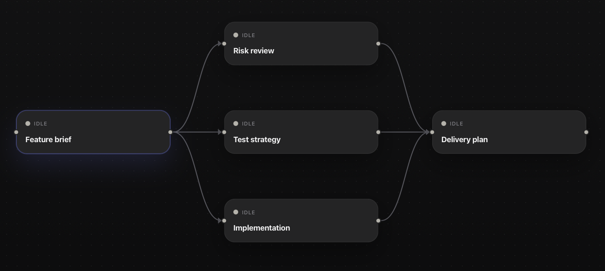
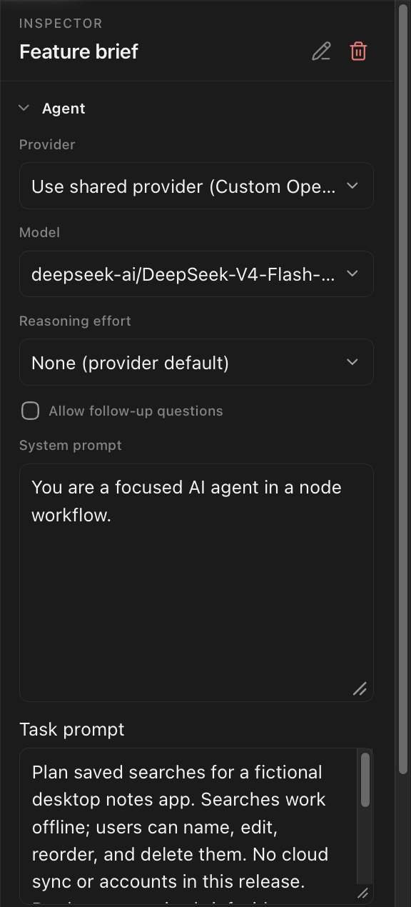

# Workflow authoring

Build a workflow by adding agent nodes and connecting their dependencies, or ask **Create with AI** to draft it. You can edit a graph locally without a ready provider. **Create with AI** and workflow runs require one.

[Your first workflow](first-workflow.md) walks through a two-node example.

## Create a workflow

From **Workflows**, select **New workflow**, then **Create new workflow**. From a project row, choose **New workflow** or **Create with AI**.

OpenFlow writes a [project workflow](projects-and-persistence.md) under `.flow/workflows/` and an app workflow in its own data directory.

The only implemented node kind is an agent node. Connect nodes to express dependencies.

<figure class="product-shot product-shot--detail" style="--shot-width: 700px">

<figcaption>Prepared example: each specialist depends on the brief; Delivery plan waits for all three. All nodes are Idle. Select the image for the complete window.</figcaption>
</figure>

OpenFlow checks for an empty graph, duplicate node IDs, missing edge endpoints, self-edges, cycles, invalid output schemas, and invalid handoff templates.

## Configure nodes and workflow settings

Select a node to open the Inspector. Configure **Provider**, **Model**, reasoning, **Allow follow-up questions**, **System prompt**, and **Task prompt**.

<figure class="product-shot product-shot--detail" style="--shot-width: 288px">

<figcaption>The Inspector configures the selected node. Task prompt sits below System prompt; scroll within the field for the rest of this prepared brief. Select the image for the complete window.</figcaption>
</figure>

The remaining Inspector sections configure the handoff format and schema, [tool approval mode, MCP context, and callable subagents](tools-and-integrations.md).

**Workflow Settings** provides the shared provider and context, speed when supported, Plan → Execute mode, default reasoning, overseer model, and retry attempts and backoff. Configure automatic runs on the separate **Schedule** screen.

An empty node model inherits the effective provider's default model. Provider order is node override, workflow provider, then the active Settings provider. The [configuration reference](../reference/configuration.md#workflow-settings) lists all workflow defaults.

## Choose an output handoff

New nodes use Markdown handoffs by default. A Markdown template must contain at least one heading, and completed output must preserve every template heading.

OpenFlow stores the result as `HANDOFF.md` and passes downstream nodes an artifact reference and hash.

Use JSON when downstream work needs typed machine data. OpenFlow validates the object against the node's JSON schema and stores `HANDOFF.json`.

Downstream nodes receive the structured output and artifact reference. Older workflows without an explicit handoff format continue to load as JSON.

## Create with AI safely

**Create with AI** opens an authoring session. Ask questions normally; the assistant proposes graph changes only after you explicitly ask to create or edit the workflow. Provider readiness is required.

Choose the target project before the first message. Project selection locks after the conversation starts, but you can change the authoring model, reasoning, and speed controls between turns.

Review the proposed graph, then select **Create Workflow** or **Apply Changes**. A proposal is not saved until that action succeeds. Authoring tool access is separate from direct-chat approval controls.

If you leave the authoring screen without cancelling, use **Resume AI workflow draft** when it is offered. **Cancel** ends the authoring session, discards its unsaved draft and conversation, and returns to the editor.

## Validate before running

Check canvas validation, provider/model readiness, prompts, edges, handoff headings, and tool approval mode. For a project workflow, OpenFlow probes `.flow` write access before starting.

Select **Run** when validation clears. [Runs and recovery](runs.md) explains questions, approvals, retries, and resume.

## Add tools and callable agents

Use **Inspector → Tools** to choose approval mode for repository tools. Configure external MCP servers in **Settings → MCP Servers**, then select their resources or prompts under **Inspector → MCP context**.

Create reusable agent definitions on the **Agents** screen and select them under **Inspector → Subagents**. OpenFlow snapshots saved agents at run start, so library edits do not affect an active run. [Tools and integrations](tools-and-integrations.md) defines approvals, MCP context, and reuse.

A saved workflow can also run at a time or interval through [Scheduling workflows](scheduling.md).
