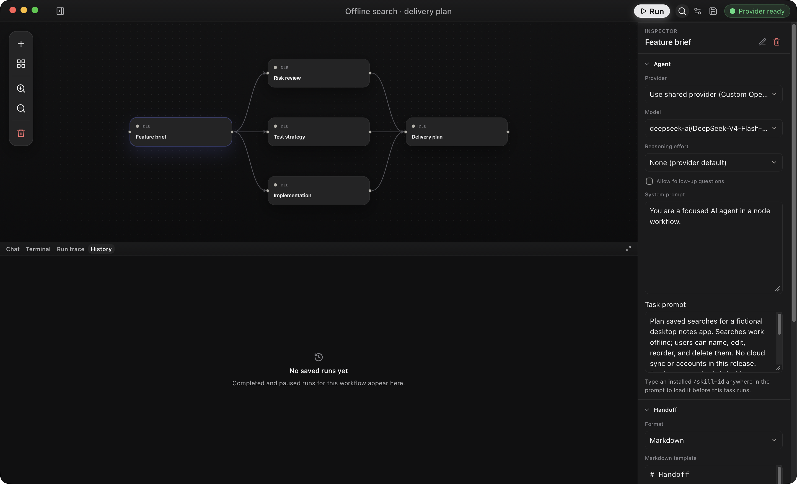
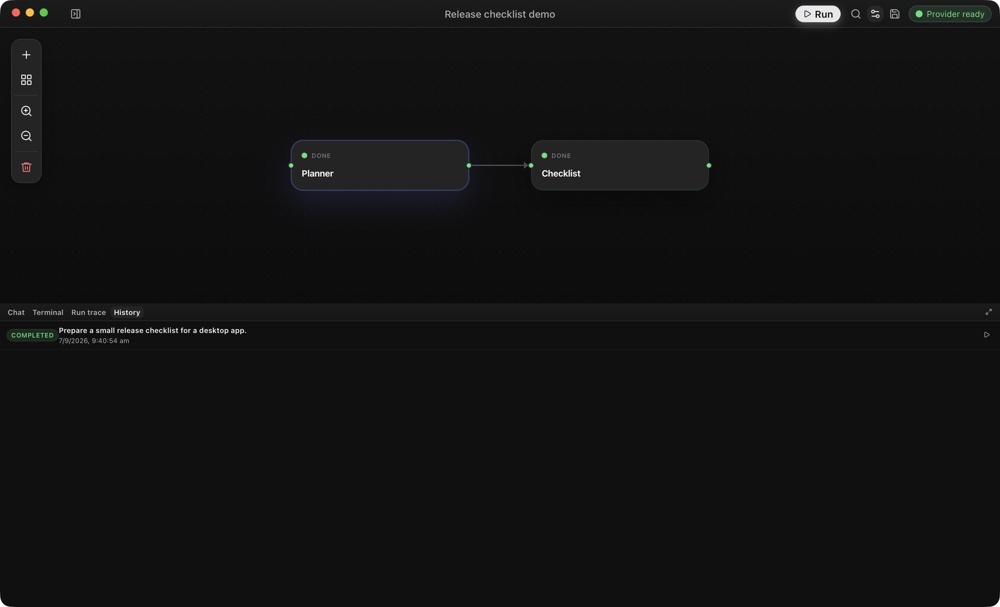

<dl class="home-points">
  
<dt>Draw the workflow</dt><dd>Each step is an agent with a prompt, a model, and tools. Connect steps to say which results feed which.</dd>

  
<dt>Run steps in parallel</dt><dd>Steps that don't depend on each other run at the same time. A step starts when everything it needs is ready.</dd>

  
<dt>Stay in control</dt><dd>Open any agent's conversation to answer its questions, approve a tool call, or retry a failed step.</dd>

  
<dt>Bring your own model</dt><dd>Use OpenAI, Anthropic, ChatGPT sign-in, Amazon Bedrock, OpenRouter, or a local model such as Ollama.</dd>

</dl>

## How a run goes

1. **Draw the workflow.** Add an agent for each step. Give it a prompt, a model, and tools, then connect it to the steps that feed it.

   

2. **Run it and watch.** Steps that don't depend on each other run at the same time. Open any agent's conversation to answer a question, approve a tool call, or retry a failed step.

   

3. **Review what happened.** History keeps every run. Open a replay to read each agent's conversation and the handoffs between them.

   

## Get started

1. [Install OpenFlow](getting-started/README.md). The macOS app needs no development tools.
2. [Connect a provider](guides/provider-setup.md) so agents can call a model.
3. [Build your first workflow](guides/first-workflow.md), or [start a direct chat](guides/direct-chats.md) if you only want to talk to one agent.

## Find what you need

| I want to… | Read |
| --- | --- |
| Understand how it works | [How OpenFlow works](concepts/how-openflow-works.md) |
| Design a workflow | [Workflow authoring](guides/workflow-authoring.md) |
| Handle approvals, retries, and failures | [Runs and recovery](guides/runs.md) |
| Look up a setting | [Configuration](reference/configuration.md) |
| Fix a problem | [Troubleshooting](troubleshooting/README.md) |
| Build it from source | [Build from source](getting-started/build-from-source.md) |
| Browse everything | [All documentation](README.md) |
