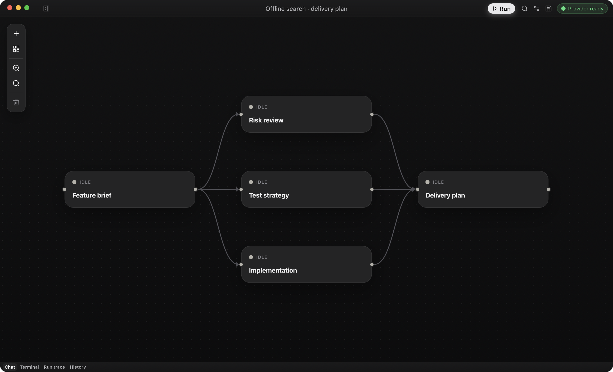

# OpenFlow documentation

OpenFlow is a desktop app for multi-agent workflows. Connect agents on a canvas, give each a task, model, and tools, then follow their conversations as they work.

Each node is an AI step. Its prompt, model, tools, and skills define the job. Edges decide which steps can run together and which need an earlier result. During a run, open a node’s conversation to answer questions, approve tools, or retry.

One brief branches into implementation, tests, and risk review. The delivery plan depends on all three. This prepared workflow shows [parallel dependencies](concepts/workflows-and-runs.md#parallel-layers) in the installed macOS app. Open the image for the full-size capture.

Use a release build without Rust or Node, or build from source. Connect an API-key provider, sign in with ChatGPT, configure AWS credentials, or use a local model server. Start with a direct chat for one conversation, or follow the two-agent walkthrough to build a planner and checklist workflow.

- [Install OpenFlow](getting-started/README.md)
- [Build from source](getting-started/build-from-source.md)
- [Connect a provider](guides/provider-setup.md)
- [Build your first workflow](guides/first-workflow.md)
- [Start a direct chat](guides/direct-chats.md)
- [Run and recover](guides/runs.md)
- [Look up configuration](reference/configuration.md)
- [Browse all documentation](README.md)
